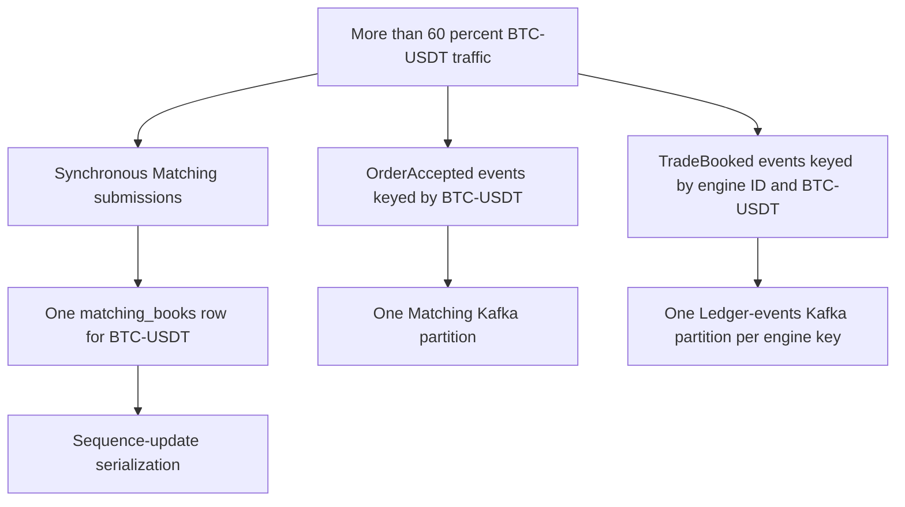
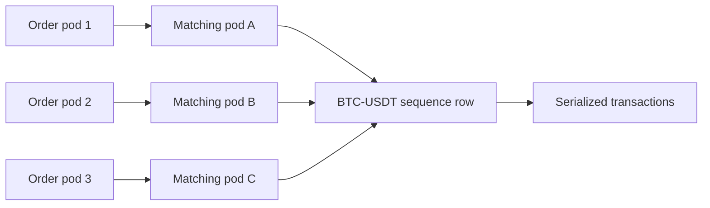
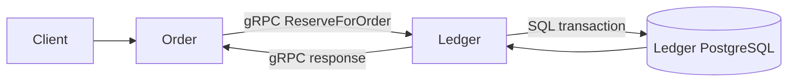
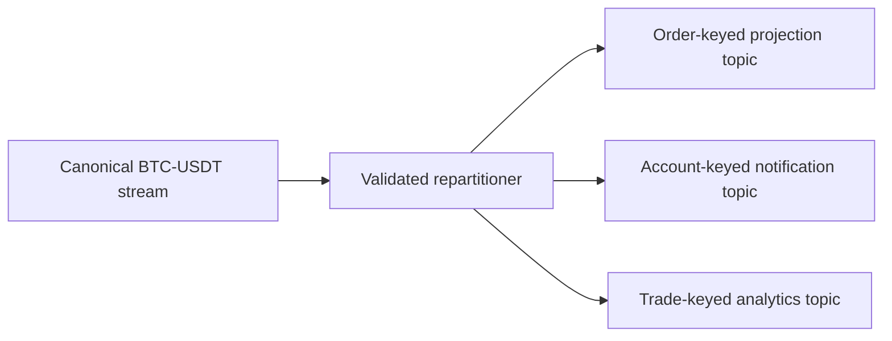

# Dominant-market hotspots

## Status

This document records a capacity risk created by the concentration of trading
activity in one market. It is a design note for future work; no mitigation
described here is currently implemented.

## Workload assumption

More than 60% of trades are expected to occur on the USDT-BTC market. Praxis
currently represents symbols in forms such as `BTC-USDT`; this document assumes
those names refer to the same dominant market. The canonical symbol name should
be confirmed before implementing metrics, policies, or migrations.

This distribution is materially different from a workload spread uniformly
across many symbols. Capacity tests and partition plans must model at least 60%
of order and trade traffic on the dominant symbol, with higher concentrations
included as stress scenarios.

## Summary

The dominant market can create three separate hotspots:

1. synchronous contention on the Matching database's per-symbol sequence row;
2. a hot Matching Kafka partition because `OrderAccepted` is keyed by symbol;
3. a hot Ledger-events partition because `TradeBooked` is keyed by engine and
   symbol.

Reservations follow a different path. Order Service calls Ledger synchronously
over gRPC, and reservation events use `user_asset_account_id` as their Kafka
key. Market concentration therefore does not place every reservation in one
Kafka partition, although a high-volume participant can still create a hot
balance row and account-keyed partition.



## Current synchronous Matching path

Order Service submits an accepted reservation to Matching over gRPC. Matching
opens a PostgreSQL transaction and assigns the next engine sequence with a
per-symbol update:

```sql
UPDATE matching_books
SET next_sequence = next_sequence + 1
WHERE symbol = $1
RETURNING next_sequence - 1;
```

Every concurrent `BTC-USDT` submission attempts to update the same row.
PostgreSQL must serialize those conflicting updates even when requests arrive
through different Matching pods.



Adding Matching replicas, gRPC balancing, connections, or Kafka partitions does
not make updates to this one database row parallel. The current transaction
also inserts the order and its outbox event, so sequence-row wait time directly
affects synchronous order-admission latency and transaction concurrency.

Likely symptoms include:

- increasing Matching gRPC latency, particularly at p95 and p99;
- time spent waiting for row locks;
- a growing number of open database transactions;
- database connection-pool saturation;
- Order request timeouts despite unused capacity on other symbols; and
- retry pressure if clients or recovery workers repeat uncertain operations.

## Current Matching event partition

Matching writes `OrderAccepted` to its outbox with `req.Symbol` as
`message_key`. The Matching relay copies that value to `kafka.Message.Key` and
uses `kafka.Hash`.

```text
BTC-USDT -> hash -> one partition
BTC-USDT -> hash -> the same partition
BTC-USDT -> hash -> the same partition
```

The production Matching topic may contain many partitions, but only one is
available to this key. If the market represents more than 60% of traffic, one
partition receives more than 60% of `OrderAccepted` records while most
partitions receive only the remaining markets.

Increasing the topic's partition count does not divide an existing key across
partitions. It can also change the partition chosen for future messages, so a
partition-count change requires an explicit ordering and cutover analysis.

## Current TradeBooked partition

Ledger publishes `TradeBooked` with this key:

```text
engine_id + ":" + symbol
```

If one engine ID owns the dominant market, most `TradeBooked` events enter one
Ledger-events partition. Multiple engine IDs spread traffic only when they
represent real, deterministic ownership domains with a defined sequencing and
reconciliation model. Creating arbitrary engine IDs merely to change hashes
would not safely parallelize one authoritative order book.

This hotspot is asynchronous. It can delay downstream projections,
notifications, reconciliation, analytics, and other event-driven consumers. It
does not by itself delay the database transaction that already booked a trade,
unless future admission control deliberately feeds event lag back into trading.

## Why reservations are different

Reservation execution does not currently go through Kafka:



The Ledger transaction updates the authoritative balance and atomically inserts
a `FundsReserved` outbox row. Kafka publication occurs later and is not on the
gRPC response path.

Reservation events use the affected `user_asset_account_id` as their Kafka
key. Different users' USDT accounts therefore normally distribute across
partitions:

```text
Alice / USDT -> uaa_A -> partition 2
Bob / USDT   -> uaa_B -> partition 17
Carol / USDT -> uaa_C -> partition 5
```

Market concentration can still increase the overall rate of USDT reservations,
but it does not collapse all users into one Kafka key. A single active market
maker remains a separate risk:

- concurrent reservations contend on that participant's one balance row; and
- events for that account enter one account-keyed Kafka partition.

These are related workload symptoms but distinct synchronous and asynchronous
bottlenecks.

## Correctness constraints

The current keys preserve important ordering scopes:

- symbol ordering for Matching events;
- engine-and-symbol ordering for booked trades; and
- account ordering for balance events.

Random key salting would distribute load but would also weaken or destroy these
guarantees. For example, publishing alternating `BTC-USDT:0` and `BTC-USDT:1`
keys allows two consumers to observe events in different orders. A consumer
cannot reconstruct an authoritative market sequence without an explicit merge
and gap-detection protocol.

Any mitigation must first state which ordering guarantee each consumer needs.
Not every projection requires the complete market stream in order, but the
authoritative order book, execution sequence, and financial booking paths do.

## Future design directions

### Dedicated market ownership

Treat the dominant market as a dedicated capacity domain with an explicitly
owned sequencer and order book. Other markets should not share its critical
worker, queue, connection pool, or resource budget where avoidable.

Dedicated ownership does not make one ordered stream infinitely parallel. It
makes capacity predictable and prevents dominant-market load from starving
unrelated markets.

### Remove the database row as the hot sequencer

Evaluate a single-writer, durable sequencer for each market rather than using a
contended PostgreSQL row as the admission serialization point. Possible designs
must address:

- leader ownership and fencing;
- durable sequence allocation;
- crash recovery without gaps or duplicate execution;
- idempotent command replay;
- replication and failover;
- deterministic order-book reconstruction; and
- reconciliation with PostgreSQL and Kafka.

Sequence blocks can reduce row-update frequency, but unused ranges create gaps
and multiple writers still need strict ownership. Gaps may be acceptable only
if consumers require monotonic uniqueness rather than contiguous execution
sequences.

### Separate canonical and derived event streams

Keep one canonical ordered stream for consumers that require complete
per-market order. Build downstream derived streams for workloads that can use a
different key:



The repartitioner must consume the canonical sequence, detect gaps and
duplicates, publish idempotently, and expose lag. Derived topics improve
parallelism for projections but do not increase the canonical matching engine's
throughput.

### Participant-level collateral subdivision

For individual hot market makers, allocate collateral to explicit strategy or
engine subaccounts:

```text
market_maker_7 / USDT / strategy_A
market_maker_7 / USDT / strategy_B
market_maker_7 / USDT / strategy_C
```

Each subaccount must own a bounded portion of collateral and remain
authoritative in one processing lane. This creates safe parallelism without two
partitions concurrently mutating the same balance. It requires explicit funding
transfers and aggregate risk limits; string-level key salting is not sufficient.

### Admission and backpressure

Introduce bounded, market-aware controls before queues become unbounded:

- per-market order and cancel rates;
- per-participant rates and outstanding-order limits;
- maximum queue age and depth;
- Ledger booking-lag thresholds;
- database lock-wait and connection-pool thresholds; and
- controlled rejection or degradation modes.

Backpressure should identify the affected market or participant rather than
unnecessarily stopping unrelated markets. Financial mutations must keep stable
idempotency keys when callers receive an uncertain outcome.

## Observability requirements

Aggregate topic or service metrics are insufficient for this workload. The
future implementation should expose:

- order, cancel, and trade rates by bounded market label;
- Matching sequence-allocation latency and database lock-wait time;
- Matching transaction and gRPC latency by market;
- Kafka bytes, records, and consumer lag per partition;
- mapping from the dominant key to its current partition;
- oldest unprocessed event age;
- downstream processing time and error rate;
- per-market admission rejections and throttling; and
- per-participant heavy hitters through bounded top-K reporting rather than
  unbounded Prometheus labels.

Account IDs, order IDs, and trade IDs must not become unrestricted metric
labels. Detailed identifiers belong in sampled traces, structured logs, or
bounded diagnostic reports.

## Capacity and failure tests

Tests should use skewed distributions rather than uniform random symbols:

1. Run steady traffic with 60%, 80%, and 95% assigned to `BTC-USDT`.
2. Test order, cancel, replace, and fill mixes separately and together.
3. Measure sequence-row lock waits, transaction duration, connection-pool use,
   and Order-to-Matching p99 latency.
4. Verify the actual Kafka partition receiving the dominant symbol and measure
   its sustainable records and bytes per second.
5. Slow the consumer of that partition and confirm unrelated partitions remain
   healthy.
6. Restart or replace the dominant market's owner while traffic continues and
   verify fencing, replay, and sequence recovery.
7. Inject a response loss after Matching commits and verify idempotent replay.
8. Accumulate an outbox backlog, recover Kafka, and verify publication does not
   create a retry or recovery storm.
9. Exercise market and participant throttles before database or partition lag
   becomes unbounded.
10. Reconcile every accepted order, execution sequence, trade, reservation, and
    balance after each failure scenario.

## Acceptance criteria for a future solution

A mitigation should not be considered complete until:

- the dominant market meets its stated throughput and p99 latency objectives;
- unrelated markets retain capacity during dominant-market overload;
- sequence ownership is unique, durable, and fenced;
- canonical event ordering and gap detection are explicitly defined;
- downstream consumers can scale without weakening financial ordering;
- Kafka and database backlog remains bounded under the target skew;
- throttling activates before unsafe lag or resource exhaustion;
- retry behavior remains idempotent and bounded; and
- recovery and reconciliation tests prove no lost or duplicated business
  effects.

## Related implementation

- `matchingengine/internal/engine/engine.go` updates the per-symbol sequence and
  stores `OrderAccepted` with the symbol as `message_key`.
- `matchingengine/internal/relay/relay.go` publishes Matching outbox rows with a
  hash-based Kafka balancer.
- `ledgerservice/internal/store/postgres.go` stores `TradeBooked` with
  `engine_id:symbol` and account events with `user_asset_account_id`.
- `outboxrelay/internal/relay/relay.go` copies Ledger outbox `message_key` values
  into Kafka record keys.
- `infra/aws/variables.tf` defines production topic partition counts.
- `infra/aws/observability-alarms.tf` defines the current Ledger consumer-lag
  alarm.
- `docs/order-saga-retry-storms.md` describes retry amplification during
  dependency failure and backlog recovery.