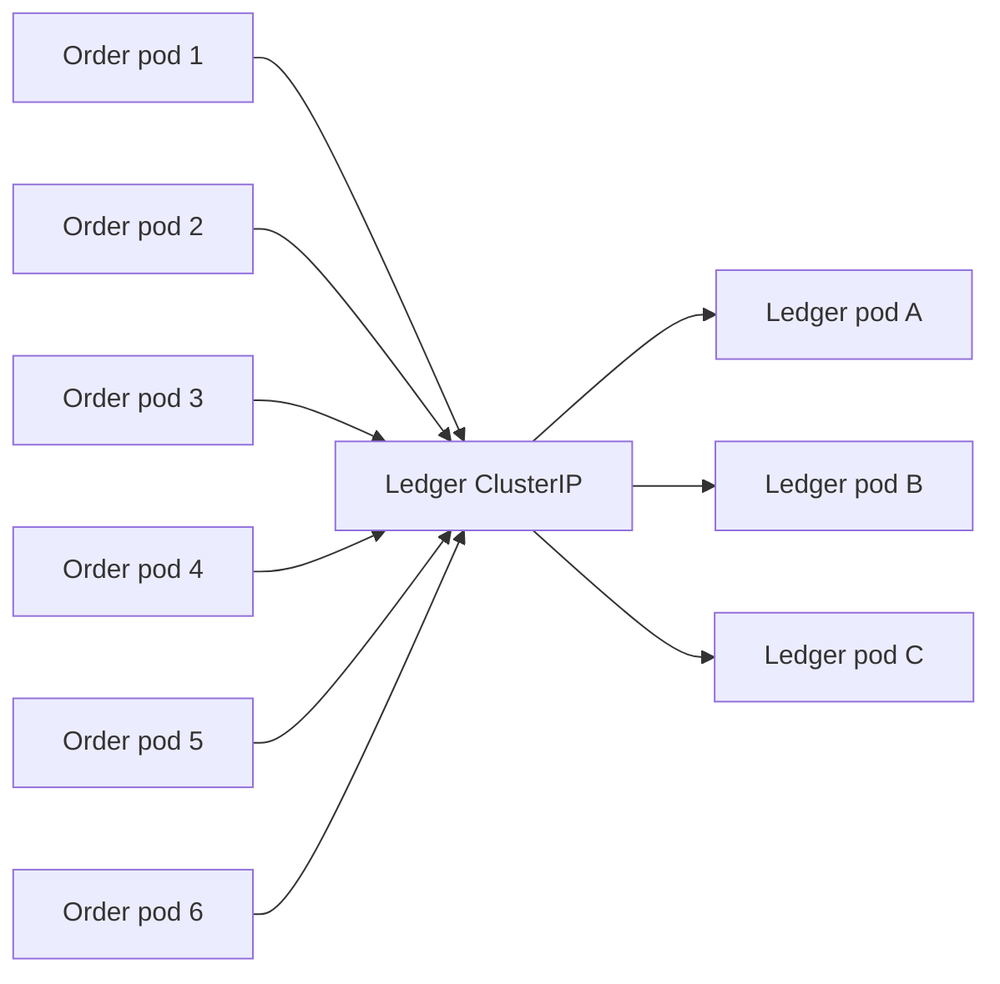
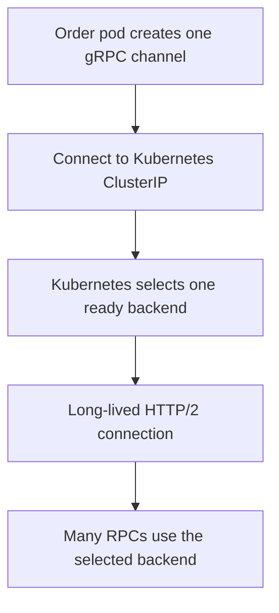
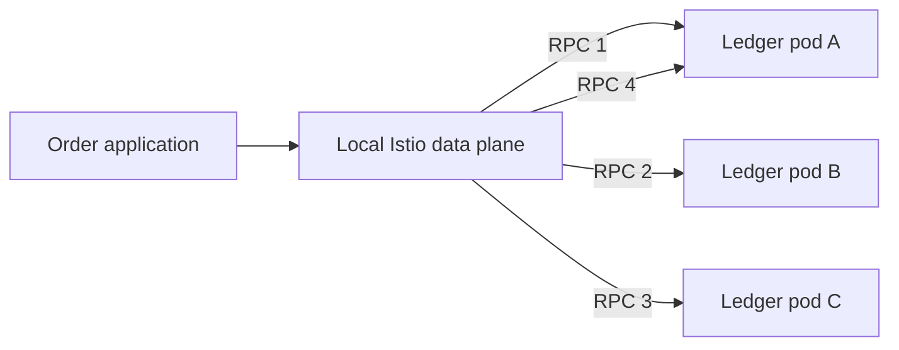

# gRPC load balancing

For a focused implementation comparison of native gRPC and Istio-managed
balancing, see [Two ways to configure gRPC load balancing](grpc-load-balancing-options.md).

## Status

This document describes Praxis gRPC traffic distribution and per-RPC load
balancing. The default deployment retains Kubernetes connection-level
selection. The repository now includes an opt-in Istio round-robin policy with
bounded connection pools; live endpoint-distribution acceptance is pending.

## Production topology

The Kubernetes deployment currently declares:

- six Order Service pods;
- three Ledger Service pods;
- three Matching Engine pods;
- one ClusterIP Service for Ledger; and
- one ClusterIP Service for Matching.

Order connects to the stable Kubernetes Service names:

```text
ledger.praxis.svc.cluster.local:9091
matching.praxis.svc.cluster.local:9092
```

Both Services specify `trafficDistribution: PreferSameZone`. This can influence
the endpoint chosen for a new connection, but it does not redistribute RPCs
already using an established HTTP/2 connection.



The same topology applies to Order-to-Matching traffic.

## Current client behavior

Each Order process creates one long-lived `grpc.ClientConn` for Ledger and one
for Matching. The clients configure transport credentials and an OpenTelemetry
stats handler, but they do not configure a resolver or load-balancing policy.
gRPC therefore uses its default `pick_first` policy.

The ordinary Kubernetes Service DNS record resolves to one virtual ClusterIP,
not to the individual Ledger or Matching pod addresses. The gRPC client sees
that virtual address, establishes a TCP connection to it, and Kubernetes
selects a backend endpoint for the connection. HTTP/2 then multiplexes many
RPCs over the same connection.



The current system therefore balances connections rather than individual RPCs.
Across six Order pods, the independent connections may produce a reasonably
even aggregate distribution, but that distribution is probabilistic. One
Ledger pod can receive several Order connections while another receives few or
none.

## Operational consequences

Connection-level balancing has several limitations:

- traffic can be uneven across Ledger or Matching replicas;
- a busy Order pod can direct all of its calls to one downstream pod;
- adding a downstream replica does not move established connections to it;
- scale-out may provide little immediate benefit until clients reconnect;
- readiness changes primarily affect new connections;
- one connection failure can disrupt all in-flight calls from an Order pod to
  that dependency; and
- the client does not have individual backend addresses on which to perform
  per-endpoint selection or health-aware balancing.

Kubernetes readiness still provides value: unready pods are removed from the
Service endpoint set, and broken connections will eventually reconnect through
the Service. This is failover at the connection boundary, not deterministic
per-RPC distribution.

## Desired properties

A future design should provide:

- discovery of all ready Ledger and Matching endpoints;
- distribution at the RPC boundary;
- prompt reaction to scale-up, scale-down, and rollout changes;
- connection draining for terminating pods;
- locality awareness without creating severe load skew;
- observable endpoint selection and error rates;
- bounded connection counts; and
- retry behavior that respects financial idempotency and a shared retry budget.

## Option 1: Istio-managed balancing

If Praxis adopts Istio for mTLS and workload authorization, the mesh can also
provide endpoint-aware balancing.



Order can continue dialing the ordinary ClusterIP Service. Istio's data plane
receives endpoint updates and selects an upstream endpoint. Depending on the
chosen data-plane mode and policy, Istio can provide:

- round-robin or least-request endpoint selection;
- endpoint discovery during deployment and autoscaling;
- locality-aware routing;
- connection-pool controls;
- outlier detection;
- workload identity and mTLS; and
- per-source and per-destination traffic telemetry.

This option centralizes transport policy outside application code. It also
adds an operational dependency on the Istio control and data planes and must be
load-tested for latency, connection, and resource overhead.

### Retry warning

Load balancing and retries must be treated as separate policies. Enabling
automatic mesh retries can multiply attempts across application, gRPC, saga,
and proxy layers. A timed-out financial mutation may already have committed.

Do not configure automatic Istio retries for a mutation until:

- the RPC has a stable idempotency key;
- the server guarantees idempotent replay semantics;
- retryable status codes are explicitly classified;
- the maximum attempts and total elapsed time are bounded; and
- proxy attempts are included in the end-to-end retry budget.

## Option 2: native gRPC client-side balancing

Without Istio, Praxis can expose Ledger and Matching through headless Kubernetes
Services. DNS for a headless Service returns individual pod addresses rather
than one virtual IP.

```yaml
apiVersion: v1
kind: Service
metadata:
  name: ledger-headless
  namespace: praxis
spec:
  clusterIP: None
  selector:
    app: ledger
  ports:
    - name: grpc
      port: 9091
      targetPort: grpc
```

Order would use an explicit DNS resolver target and the built-in `round_robin`
policy:

```go
connection, err := grpc.NewClient(
    "dns:///ledger-headless.praxis.svc.cluster.local:9091",
    grpc.WithDefaultServiceConfig(
        `{"loadBalancingConfig":[{"round_robin":{}}]}`,
    ),
    grpc.WithTransportCredentials(credentials),
    grpc.WithStatsHandler(otelgrpc.NewClientHandler()),
)
```

The gRPC client can then maintain subchannels to several ready pod addresses
and select one for each unary RPC.

Adding `round_robin` while retaining only the current ClusterIP target would
not solve the problem: the standard DNS resolver would still return one virtual
IP, so the client would not see the individual backends.

This option avoids a service mesh but moves endpoint and policy concerns into
each client. It requires careful testing of DNS update timing, rollout
draining, gRPC health checking, mTLS server-name verification, retry policy,
and backend-level metrics.

## Option 3: multiple connections to the ClusterIP

Order could maintain a pool of connections to the current ClusterIP. Kubernetes
would make an independent backend choice for each TCP connection, increasing
the chance of using more replicas.

This is not a strong long-term design:

- connections can still converge on the same backend;
- distribution remains probabilistic;
- clients cannot identify or reason about individual endpoints;
- scaling remains dependent on connection churn; and
- more connections are consumed without a balancing guarantee.

This approach may reduce skew temporarily but should not be treated as
endpoint-aware load balancing.

## Comparison

| Property | Current ClusterIP | Istio | Headless plus gRPC round robin |
| --- | --- | --- | --- |
| Selection boundary | TCP connection | RPC or upstream stream | RPC |
| Client sees pod endpoints | No | Data plane does | Yes |
| Application changes | None | Usually none | Client and Service configuration |
| mTLS and identity | Not currently | Integrated | Application-managed |
| Central traffic policy | Kubernetes L4 only | Yes | No |
| Per-endpoint telemetry | Limited | Strong | Must be added |
| Operational complexity | Low | Mesh operations | Client and DNS operations |

## Recommended direction

Because Istio is already being considered for service identity, mTLS,
authorization, and transport observability, it is the preferred long-term
place for Praxis endpoint balancing.

The recommended sequence is:

1. measure the current per-pod connection and request distribution;
2. retain the existing ClusterIP Services during initial Istio enrollment;
3. begin with a simple round-robin or least-request policy;
4. verify endpoint updates during scaling and rolling deployments;
5. add locality preference only after measuring cross-zone cost and load skew;
6. configure conservative connection pools and outlier detection;
7. keep proxy retries disabled until each RPC's retry contract is documented;
8. expose per-destination workload metrics and alerts; and
9. load-test throughput, tail latency, failure recovery, and graceful drain.

If Istio is postponed, the preferred alternative is a headless Service with
native gRPC `round_robin`, not a manually sized pool of ClusterIP connections.

## Verification scenarios

The eventual implementation should test:

1. A sustained unary RPC workload is distributed across every ready Ledger and
   Matching replica.
2. Adding a replica causes it to receive traffic without restarting Order.
3. A terminating pod stops receiving new RPCs and completes or cancels existing
   work within the shutdown deadline.
4. An unready or failed pod is removed from selection promptly.
5. One slow pod does not dominate tail latency or trigger an unbounded retry
   wave.
6. Zone preference does not overload a small local endpoint set.
7. Idempotent replay remains correct when a connection fails after the server
   commits but before the client receives the response.
8. Per-backend request, error, latency, connection, and retry metrics identify
   the actual selected endpoint.
9. Balancing remains effective at the declared six-to-three Order-to-downstream
   replica ratio and at expected autoscaling limits.

## Related implementation

- `infra/k8s/workloads.yaml` defines the ClusterIP Services, replica counts,
  topology preferences, and Order's downstream addresses.
- `orderservice/internal/adapters/ledger.go` creates the long-lived Ledger gRPC
  connection.
- `orderservice/internal/adapters/matching.go` creates the long-lived Matching
  gRPC connection.
- `ledgerservice/cmd/ledger-service/main.go` and
  `matchingengine/cmd/matching-engine/main.go` expose the downstream gRPC
  servers and standard health services.
- `docs/observability-and-istio.md` describes the proposed mesh telemetry
  integration.
- `docs/order-saga-retry-storms.md` describes retry amplification risks that
  must be considered before enabling client or proxy retries.

## References

- [gRPC custom load-balancing policies](https://grpc.io/docs/guides/custom-load-balancing/)
- [gRPC service configuration](https://grpc.io/docs/guides/service-config/)
- [gRPC custom name resolution](https://grpc.io/docs/guides/custom-name-resolution/)
