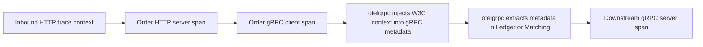
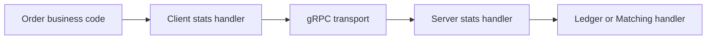
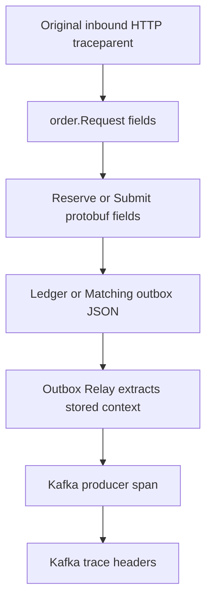
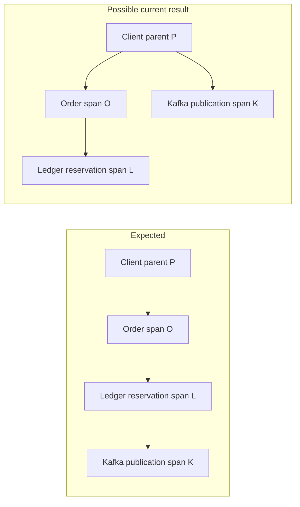
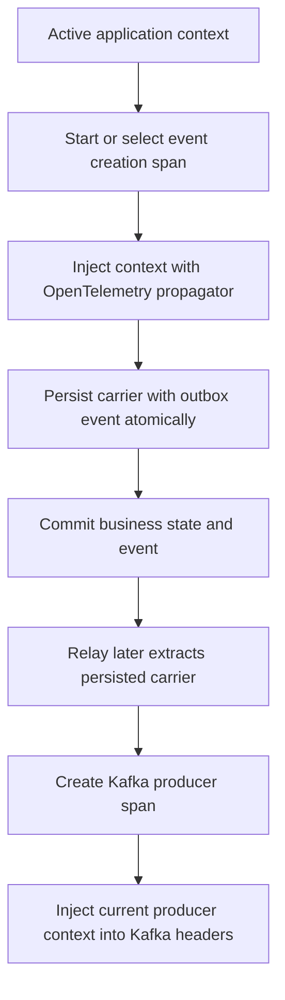

# gRPC and durable trace-context propagation

## Status

Implemented for synchronous gRPC metadata, context-aware Ledger and Matching
outbox creation, and linked saga-recovery traces. Explicit protobuf trace
fields remain temporarily for wire compatibility but are no longer populated
by Order or authoritative for new outbox events.

## Summary

Praxis propagates trace context through two mechanisms:

1. OpenTelemetry gRPC instrumentation automatically injects the active trace
   context into gRPC metadata and extracts it at the receiving service.
2. Ledger and Matching inject their active server context into durable outbox
   event payloads so the context can cross the later PostgreSQL and Kafka
   boundary.

The first mechanism handles live calls. The second is required for durable
asynchronous work because transient gRPC metadata is not automatically stored
with an outbox event. New events use the active context at creation time;
legacy protobuf trace fields are ignored.

## Current synchronous gRPC flow

Order's Ledger and Matching clients install
`otelgrpc.NewClientHandler()`. Ledger and Matching servers install
`otelgrpc.NewServerHandler()`.

The client handler takes the active OpenTelemetry context, injects it into an
outgoing `metadata.MD`, and creates the gRPC client span. The server handler
extracts the context from incoming metadata and creates the corresponding
server span.



Praxis application code does not need to call
`metadata.NewOutgoingContext` for ordinary trace propagation. The OpenTelemetry
gRPC handler performs this operation.

### Stats handlers, not interceptors

Praxis does not currently register gRPC client or server interceptors. There
are no unary or stream interceptor chains around the Ledger and Matching RPCs.
Instead, it registers OpenTelemetry implementations of gRPC's `stats.Handler`
interface:

```go
// Order's Ledger and Matching clients.
grpc.WithStatsHandler(otelgrpc.NewClientHandler())

// Ledger and Matching servers.
grpc.StatsHandler(otelgrpc.NewServerHandler())
```

A stats handler receives connection and RPC lifecycle events and is sufficient
for the current span creation and metadata injection or extraction. An
interceptor is different middleware: it wraps an RPC invocation or handler and
can inspect the method and request, reject the call, modify its context, or
apply application policy before and after business logic.



If Praxis later needs native gRPC authentication, method authorization,
correlation validation, rate limiting, panic recovery, or audit policy, unary
server and possibly client interceptors are appropriate. They should be added
for those policies rather than to replace the OpenTelemetry stats handlers.
With Istio, workload mTLS and coarse service-to-service authorization can stay
in the mesh, while interceptors remain useful for business-level authorization
and application audit context.

## Previous durable propagation flow

Order separately validates the inbound HTTP `traceparent` and `tracestate`
headers and copies their raw values into `order.Request`. The Ledger reservation
and Matching submission adapters then copy those values into protobuf fields.
The receiving service places the same values in its outbox JSON. Outbox Relay
later extracts them, creates a Kafka producer span, and writes trace headers to
the Kafka message.



This path makes trace context durable across a database commit, process crash,
delayed relay, and Kafka publication. That durability is valuable, but the
context being persisted is not necessarily the correct immediate parent.

## The lineage problem

Consider an inbound request with parent span `P`. Order creates HTTP server
span `O`, then the gRPC client and server instrumentation create spans for the
Ledger reservation. At the moment Ledger inserts `FundsReserved`, the active
context is a descendant of `O`.

The explicit protobuf field, however, still contains the original header for
`P`. When Outbox Relay later extracts that value, the Kafka publication is
attached beneath `P` rather than beneath the operation that actually created
the event.



The resulting trace may look complete at first glance, but it misrepresents
causality and can make latency analysis confusing. The event publication may
appear to be a sibling of the Order operation rather than its descendant.

The two values can also diverge during saga recovery. A recovered saga retains
the original HTTP trace fields in its persisted request, while the recovery
worker executes in a new process context and `otelgrpc` creates a new runtime
trace. The synchronous retry and its eventual event can therefore appear in
different trace trees.

## Release-event gap

The release path relies on automatic gRPC metadata for its live synchronous
trace, but it does not persist trace context for the resulting
`FundsReleased` event:

- `ReleaseOrderReservationRequest` has no `trace_parent` or `trace_state`
  fields;
- `ledger.ReleaseOrderReservation` has no trace-context fields; and
- the generic Ledger outbox helper passes empty trace values to the payload.

Consequently, a later Outbox Relay publication cannot continue the release
operation's trace using the persisted event. Correlation and causation IDs are
still present, but they do not replace an OpenTelemetry span context.

## Correlation, causation, and trace identifiers

These identifiers have separate purposes and should remain separate:

| Value | Purpose | Durability |
| --- | --- | --- |
| Request ID | Idempotency or identity of one command attempt | Durable |
| Correlation ID | Groups a business workflow across operations | Durable |
| Causation ID | Identifies the command or event that caused another event | Durable |
| Trace context | Connects sampled runtime operations in a trace graph | Propagated and selectively persisted |

An application must not derive financial idempotency or business causality
from a trace ID. Traces can be unsampled, restarted, or split intentionally
across long-running workflows.

## Implemented design

### Synchronous calls

Use OpenTelemetry instrumentation as the sole source of trace propagation for
live HTTP and gRPC calls:

- keep `otelhttp` around HTTP handlers;
- keep `otelgrpc` client and server handlers;
- pass the active `context.Context` to every downstream call; and
- avoid manually creating gRPC trace metadata.

Explicit protobuf trace fields are not required merely to continue a
synchronous gRPC trace.

### Durable outbox events

At the point where a service creates an outbox event:

1. obtain the current active context;
2. ensure the operation has an appropriate application or producer span;
3. use the configured OpenTelemetry propagator to inject that context into a
   small W3C carrier;
4. persist the resulting `traceparent` and `tracestate` alongside the outbox
   event in the same database transaction; and
5. have Outbox Relay extract the persisted carrier before creating its producer
   span and Kafka headers.



This removes the need to forward raw inbound trace strings through every
business request type solely for future outbox creation.

### Saga recovery

A recovery attempt should create a new explicit recovery span. The system must
choose and document whether the attempt:

- starts a new trace and records the durable correlation ID; or
- links to a valid previously persisted span context using an OpenTelemetry
  span link.

For long delays and operational retries, a new trace with a span link is often
clearer than pretending the recovery attempt is a continuously executing child
of the original request. The decision should be consistent for reservation and
release recovery.

### Release and other Ledger events

All outbox-producing Ledger operations should use one context-aware event
builder. This includes reservation, release, deposits, holds, trades, and any
future event type. A shared builder reduces the current difference between the
special reservation payload and the generic helper that writes empty trace
fields.

The event builder should accept `context.Context`, correlation ID, causation ID,
and event data. It should derive trace propagation fields from the context, not
from client-controlled payload strings.

## Security and validation

Inbound trace headers are untrusted telemetry input. They must never grant
authorization, select a tenant, control idempotency, or be copied into
high-cardinality metric labels.

Use the OpenTelemetry propagator to parse and inject trace context rather than
maintaining separate application parsers where possible. Apply limits to
`tracestate` and baggage, do not log baggage indiscriminately, and do not allow
sensitive business data in propagation fields.

## Migration status

1. [x] Add trace-propagation tests that capture outgoing gRPC metadata and verify
   that it represents the active client span.
2. [x] Introduce a context-aware outbox carrier helper with unit tests.
3. [x] Convert Ledger reservation and release event creation to the helper.
4. [x] Convert Matching event creation to the helper.
5. [x] Define the saga-recovery span and link policy.
6. [ ] Remove explicit protobuf trace fields after all durable producers derive
   context locally and compatibility requirements permit their removal.
7. Regenerate protobuf code and update integration tests.
8. Verify complete traces through HTTP, gRPC, PostgreSQL outbox, relay, Kafka,
   retry, and crash-recovery scenarios.

During migration, receivers may temporarily accept both representations, but
the locally injected active context should be authoritative for newly created
events. Do not silently overwrite a newer active context with an older payload
field.

## Verification scenarios

The implementation and deployment verification should demonstrate:

1. An HTTP order trace continues through Order, Ledger, and Matching via gRPC
   metadata without explicit protobuf trace fields.
2. `FundsReserved`, `FundsReleased`, and `OrderAccepted` persist the active
   event-creation context.
3. Outbox publication spans are causally connected to the operation that
   inserted the event.
4. Kafka messages contain the relay producer span context, not merely the
   original inbound HTTP header.
5. A process crash after database commit and before publication preserves trace
   continuation when the relay resumes.
6. A delayed saga retry follows the documented new-trace or span-link policy.
7. Missing, malformed, unsampled, and oversized propagation values fail safely
   without affecting the business transaction.
8. Correlation and causation IDs remain stable even when trace sampling is
   disabled or a new recovery trace is created.

## Related implementation

- `orderservice/internal/observability/tracing.go` configures the W3C
  propagator and trace provider.
- `orderservice/internal/adapters/ledger.go` and `matching.go` install gRPC
  client handlers; they retain but no longer populate explicit protobuf trace
  fields.
- `ledgerservice/cmd/ledger-service/main.go` and
  `matchingengine/cmd/matching-engine/main.go` install gRPC server handlers.
- `orderservice/internal/transport/request_context.go` currently validates and
  copies raw inbound trace headers.
- `ledgerservice/internal/store/postgres.go` and
  `matchingengine/internal/engine/engine.go` create outbox payloads.
- `outboxrelay/internal/relay/relay.go` extracts stored context and injects
  Kafka headers.
- `api/proto/ledger/v1/ledger.proto` and
  `api/proto/matching/v1/matching.proto` define the current explicit trace
  fields and the release-path gap.
