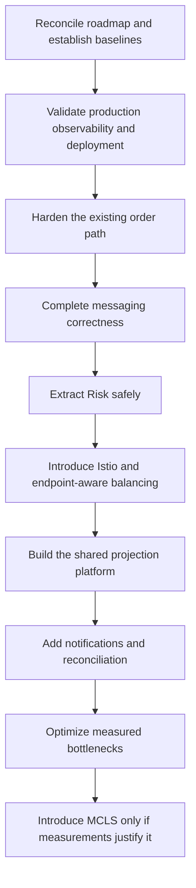

# Praxis implementation roadmap

## Status

This document orders the work proposed across the Praxis design notes. It is a
planning document, not a statement that the described capabilities are already
implemented.

The documents should not be implemented independently or in filename order.
Several proposals share foundations, some introduce safety requirements for
later work, and some are engineering guidance rather than standalone projects.

## Delivery principles

Apply the following sequence to every phase:

1. Reconcile the design note with the current code and infrastructure.
2. Resolve ambiguous behavior in an ADR or versioned contract.
3. Define metrics, safety limits, acceptance criteria, and rollback before
   implementation.
4. Add unit, contract, integration, and failure tests appropriate to the risk.
5. Implement the smallest deployable slice behind configuration or a feature
   flag.
6. Use observe-only, shadow, or canary rollout where practical.
7. Verify dashboards, alerts, failure behavior, and rollback.
8. Update the source document to distinguish implemented behavior from
   remaining proposals.

The overall dependency path is:

## Phase control matrix

Each phase is independently deployable and must preserve the last accepted
state. A later phase does not waive an earlier gate.

| Phase | Required verification | Rollback boundary |
| --- | --- | --- |
| 0. Governance and baseline | ADR review, link and formatting checks, repeatable local profile, financial-integrity checks | Revert an unaccepted ADR or roadmap change; documentation does not mutate runtime state. |
| 1. Observability and deployment | Live metric, trace, log, alert, failure, and rollback exercises in non-production | Route back to the last verified workload revision and collector configuration; infrastructure state and data services remain intact. |
| 2. Current-path hardening | Multi-worker saga tests, overload tests, propagation contracts, and observe-only limiter comparison | Disable new limiter and retry controls by configuration; roll back code only while migrations remain backward compatible. |
| 3. Messaging correctness | Crash-window, duplicate, poison-record, replay, ordering, and compatibility tests | Stop new consumers or producers, retain old schemas and topics, and resume from recorded offsets; never delete the prior stream during acceptance. |
| 4. Risk extraction | Shadow equivalence, deadline behavior, failure policy, and load tests | Feature-flag admission back to the embedded implementation while preserving decision audit. |
| 5. Istio and balancing | Identity denial, mTLS, endpoint distribution, drain, overload, and correlated-failure tests | Remove traffic policy or unenroll one workload at a time using the rehearsed mesh rollback; keep application retry behavior unchanged. |
| 6. Projection platform | Rebuild, catch-up, reconciliation, stale-version, and atomic read-cutover tests | Switch reads back to the previous projection tables; retain both generations until validation completes. |
| 7. Notifications | Authorization, duplicate, reconnect, slow-client, provider-outage, and replay tests | Disable a delivery channel or consumer without changing committed order state; clients fall back to snapshots and polling. |
| 8. Reconciliation and analytics | Checkpoint reproducibility, invariant comparison, export completeness, and approval audit | Stop derived pipelines and return to the prior report/checkpoint; repair commands remain separately controlled. |
| 9. Scaling and MCLS | Capacity proof, fencing, shadow accounting, failure injection, reconciliation, and cutover rehearsal | Roll back optimizations independently; an MCLS authority reversal requires paused admission, drained settlement, deterministic journal replay, reconciliation, and a new routing epoch. |

Any database migration in these phases must be expand-and-contract or otherwise
backward compatible through the rollback window. A destructive contraction is
a separate change after the old application version can no longer receive
traffic.

## Phase 0: reconcile the roadmap and establish gates

Status: repository governance complete; production-like measurements remain a
Phase 1 environment gate.

Primary documents:

- [Microservices migration](microservices-migration.md)
- [ADR 0001](adr/0001-synchronous-calls-and-kafka.md)
- [ADR 0002](adr/0002-service-and-data-ownership.md)
- [ADR 0003](adr/0003-kafka-keys-and-ordering.md)
- [ADR 0004](adr/0004-retries-and-failure-policy.md)
- [ADR 0005](adr/0005-event-envelope-compatibility.md)
- [ADR 0006](adr/0006-authoritative-and-derived-state.md)
- [Kafka partition expansion](kafka-partition-expansion.md)

Work:

1. [x] Make this document the authoritative delivery roadmap and keep service
   boundaries and topology in the microservices migration document.
2. [x] Clearly archive superseded Fargate and ECS-on-EC2 hot-path phases.
3. [x] Add ADRs for service and data ownership, Kafka partition keys, retry
   policy, event-envelope compatibility, and authoritative versus derived
   state.
4. [x] Convert phases into independently testable work items with rollback
   criteria.
5. [x] Record a reproducible local throughput, latency, failure, database, and
   financial-integrity baseline.
6. [ ] Record Kafka lag, outbox age, per-pod distribution, zone behavior, and
   database saturation in the deployed topology during Phase 1.

Repository exit gate: complete. Architecture decisions are explicit, the
documented deployment path matches the repository, and a local baseline exists.
See [Phase 0 baseline](phase-0-baseline.md). Production capacity and SLO values
remain deliberately unset until the deployed topology is measured in Phase 1.

## Phase 1: validate production observability and deployment

Status: repository controls implemented; non-production apply, live evidence,
failure exercises, and acceptance approval remain pending. See
[Phase 1 production-like baseline](phase-1-production-baseline.md).

Primary documents:

- [Observability and Istio](observability-and-istio.md), baseline work only
- [Microservices migration](microservices-migration.md)
- [Go memory retention](go-memory-retention.md)

Work:

1. Deploy the existing EKS, ADOT, AMP, X-Ray, and Grafana configuration in a
   non-production AWS environment.
2. Verify real metric and trace ingestion.
3. Pin collector images and configure authentication, sampling, retention,
   alarms, and complete resource metadata.
4. Complete authenticated Order ingress.
5. Add dashboards for RED metrics, database saturation, Kafka lag, outbox
   backlog, saga retries, dead letters, and pod-level load distribution.
6. Establish a secure profiling procedure based on the memory troubleshooting
   runbook.
7. Exercise task, pod, node, Availability Zone, database, broker, and collector
   failures.

This work comes first because every later phase needs evidence that behavior
improved and that regressions are visible.

Exit gate: production-like traffic is observable end to end, alerts work, and
deployment rollback has been rehearsed.

## Phase 2: harden the existing order path

Status: Phase 2.1 lease-based saga recovery and Phase 2.2 trace propagation are
implemented in the repository. Phase 2.3 local concurrency protection and
observe-only token buckets are implemented; capacity measurement, authenticated
identity, and a shared authoritative limiter remain deployment prerequisites.

Primary documents:

- [Order saga retry storms](order-saga-retry-storms.md)
- [gRPC trace-context propagation](grpc-trace-context-propagation.md)
- [Order API rate limiting](order-api-rate-limiting.md)

### 2.1 Make saga recovery safe across replicas

1. [x] Add claim-owner and lease-expiry fields to sagas.
2. [x] Claim due work transactionally with `FOR UPDATE SKIP LOCKED`.
3. [x] Verify lease ownership during every claimed state transition.
4. [x] Add full retry jitter, including worker-start jitter.
5. [x] Bound reservation and release retry concurrency separately.
6. [x] Reserve downstream capacity for new requests by clamping recovery claim
   concurrency to the configured downstream budget minus the admission reserve.
7. [x] Add retry, lease, duplication, and backlog metrics. Claim, active-claim,
   retry-attempt, panic, dead-letter, database backlog age, lease-expiration,
   and downstream idempotent-replay metrics are implemented.
8. [x] Test simultaneous workers, dependency outages, recovery surges, and
   expired leases. Bounded recovery surges, database-backed competing claims,
   expired-lease takeover, stale-owner rejection, and bounded dependency-outage
   recovery are covered.

This is the highest-priority service change because several replicas can
currently select the same due saga.

### 2.2 Correct trace propagation

1. [x] Add propagation contract tests for outgoing gRPC metadata.
2. [x] Introduce a context-aware outbox carrier.
3. [x] Correct Ledger reservation and release event context.
4. [x] Correct Matching event context.
5. [x] Define span-link or new-trace behavior for delayed saga recovery.
6. [ ] Remove explicit protobuf trace fields only after compatibility permits
   it. Order no longer populates them and outbox producers no longer trust
   them.

Correlation and causation identifiers remain durable business identifiers;
trace identifiers do not replace them.

### 2.3 Add admission control and rate limiting

1. Measure the sustainable capacity of Order, Ledger, and Matching.
2. [x] Add bounded local concurrency and request queues.
3. Introduce shared account, API-key, market, and global token buckets.
4. [x] Run the limiter in observe-only mode. Local global, account, and market
   decisions are measured; authoritative cross-replica enforcement remains
   disabled.
5. Enable generous limits and tune them using measured behavior.
6. [x] Return `429 Too Many Requests` for quota rejection and `503 Service
   Unavailable` when the authoritative limiter fails.
7. [x] Verify that rejection occurs before financial side effects.

Exit gate: overload produces bounded rejection, retries do not synchronize into
a storm, and only one worker owns a saga attempt.

## Phase 3: complete messaging correctness

Primary documents:

- [Kafka topology inventory](kafka-topology-inventory.md)
- [Kafka dead-letter queues](kafka-dead-letter-queues.md)
- [Event replay and projections](event-replay-and-projections.md)
- [Kafka partition expansion](kafka-partition-expansion.md)
- [Microservices migration](microservices-migration.md)

Work:

1. [x] Inventory every topic, producer, consumer group, partition key, schema, and
   ordering guarantee.
2. [x] Define versioned event and DLQ envelopes, with legacy unversioned event
   decoding retained for the compatibility window.
3. [x] Add transactional outboxes wherever domain state and event publication
   are not yet atomic. All implemented producers use a domain-local outbox.
4. [x] Add transactional inbox deduplication to consumers. Ledger command
   mutations and their inbox record now share one PostgreSQL transaction.
5. [x] Create a DLQ for each implemented source consumer, beginning with
   `ledger.commands.dlq.v1`.
6. [x] Implement atomic DLQ handoff and source-offset commit. Ledger commits
   the DLQ outbox row and inbox marker together before committing the Kafka
   source offset; deterministic IDs make crash-window redelivery harmless.
7. [x] Define deterministic and transient failure classes. Envelope, schema,
   and unsupported-type failures are deterministic; runtime, database,
   cancellation, and ordering failures remain transient.
8. [x] Add audited, authorized, rate-limited DLQ inspection and selective
   replay. Ledger provides a narrowly scoped operator CLI with exact
   partition/offset bounds, metadata-only inspection, allowlisted identity,
   durable PostgreSQL audit records, explicit replay approval, and paced
   publication that preserves original record bytes and headers.
9. Add projection rebuild tooling that uses new consumer groups and new tables.
   Implementation begins with the first Phase 6 projection so its event,
   storage-generation, validation, and cutover contracts are concrete; Praxis
   does not add a storage-agnostic replay command that could accidentally run
   side-effecting consumers.
10. [x] Prohibit casual in-place partition-count changes for order-sensitive
    topics. Terraform freezes the accepted counts unless an explicit migration
    override is enabled; versioned-topic migration remains the default.
11. [x] Test partition migration using realistic backlog and dominant-market
    skew. The deterministic repository rehearsal uses the production hash
    balancer at 60%, 80%, and 95% dominant-market traffic, proves that an
    online remap can overtake old backlog, and verifies that a drain barrier
    eliminates cross-mapping overlap. Broker rebalance and downstream
    reconciliation remain deployment acceptance exercises.

Replay tooling follows idempotency and side-effect isolation. Otherwise a
replay could repeat financial or external effects.

Exit gate: poison records cannot stop a partition indefinitely, replay is
controlled and auditable, and redelivery produces no duplicate business
effect.

## Phase 4: extract Risk safely

Status: repository implementation complete; non-production deployment, live
shadow evidence, telemetry verification, and rollback rehearsal remain
environment acceptance gates.

Primary document:

- [Microservices migration](microservices-migration.md)

Work:

1. [x] Put the existing risk calculation behind an internal interface. Order
   now depends on `RiskChecker`; the embedded deterministic policy implements
   that contract and preserves fail-closed evaluation before saga or financial
   side effects.
2. [x] Define a versioned `CheckOrder` gRPC contract. `risk.v1` carries exact
   decision inputs, an explicit non-default approval decision, stable decision
   and policy identifiers, and durable business correlation while trace
   context remains in standard gRPC metadata.
3. [x] Add an independently deployable Risk service with independent state
   ownership and telemetry. The repository
   now contains an independently runnable Risk service and container with
   service-owned immutable policy configuration, health/readiness endpoints,
   bounded decision metrics, and a private digest-pinned EKS deployment
   definition with zone spreading, disruption protection, and autoscaling.
   A non-production apply and live telemetry evidence remain environment gates;
   persistent dynamic policy/audit storage is deferred until policy mutation
   is introduced.
4. [x] Run the service in shadow mode and compare its decisions with the embedded
   calculation. Order now supports bounded asynchronous shadow calls with
   strict per-call timeouts and match, mismatch, error, and dropped-work
   metrics; the embedded checker remains authoritative. Production-like
   Golden decision vectors and bounded-load tests verify repository behavior;
   production-like comparison evidence remains an environment gate.
5. [x] Cut over through a feature flag with a strict deadline and explicit
   fail-closed behavior. `ORDER_RISK_REMOTE_MODE=authoritative` selects the
   remote checker, makes Risk part of Order readiness, and returns `503` before
   side effects on deadline, transport, or invalid-decision failure. The EKS
   definition remains in `shadow` until comparison evidence is accepted.
6. [x] Retain immediate rollback until the independent service is proven. Setting
   `ORDER_RISK_REMOTE_MODE=off` restores the embedded checker; mode-selection
   tests verify authority reversal without changing request semantics. A live
   rollback rehearsal remains required before authoritative activation.

Exit gate: there are no unexplained shadow mismatches, failure behavior is
explicit, and rollback is tested.

Repository exit gate: complete. Separate embedded and remote golden vectors,
strict-deadline and fail-closed tests, bounded shadow-load tests, and authority
rollback tests pass. The phase is not accepted for authoritative production
traffic until the environment gates in the status above are evidenced.

## Phase 5: introduce Istio and endpoint-aware load balancing

Status: the first repository slice is implemented behind
`enable_istio_mesh=false`. It provides selective sidecar enrollment,
workload-scoped mTLS, Order identity authorization for financial gRPC ports,
round-robin endpoint policy, bounded connection pools, and curated proxy
metrics plus error-only access logging. A pinned control-plane installation,
non-production rollout, live telemetry and identity evidence, failure testing,
and rollback rehearsal remain environment gates. The repository now includes
pinned platform chart preparation with CNI for restricted Pod Security,
incremental enrollment, health-only identity probes, AMP evidence capture and
a [failure/capacity acceptance procedure](phase-5-acceptance.md). Proxy retries
and outlier detection remain disabled; outlier policy implementation still
depends on measured capacity and recovery safeguards.

Primary documents:

- [Istio installation](istio-installation.md)
- [Observability and Istio](observability-and-istio.md)
- [gRPC load balancing](grpc-load-balancing.md)
- [Outlier detection and ejection spirals](outlier-detection-ejection-spirals.md)

Work:

1. [x] Add opt-in enrollment for Order, Ledger, and Matching. Workload selection
   now supports Order-first enrollment and backend-first rollback; incremental
   live enrollment remains an environment gate.
2. [x] Establish mTLS and workload authorization for internal financial gRPC
   ports while preserving explicitly identified health, metrics, and ingress
   ports. Digest-pinned health-only probe Jobs test Order allow and dedicated
   identity denial without financial mutations; live execution remains an
   environment gate.
3. Confirm that existing application metrics and traces remain intact. The
   repository now includes a Mesh Acceptance dashboard with independent
   application rate/latency panels next to destination-side mesh metrics;
   live comparison and trace verification remain environment gates.
4. [x] Add allowlisted mesh request metrics and filtered error/denial access
   logging. Live AMP ingestion, CloudWatch search, sensitive-data inspection,
   and retention verification remain environment gates. The managed Grafana
   stack now imports per-backend-pod traffic distribution, transport security,
   HTTP/gRPC outcomes, mesh latency, and scrape-health panels using the existing
   curated metric labels. Its runbook requires comparison with ready endpoint
   inventories rather than treating absent series as successful distribution.
   The collector preserves histogram bucket boundaries (`le`), with a regression
   check covering dashboard label compatibility.
5. [x] Add opt-in endpoint-aware round-robin balancing; live distribution
   evidence remains an environment gate.
6. Test scale-out, rolling drain, zone behavior, and backend distribution.
   A read-only repository preflight now verifies sidecar readiness, proxy
   synchronization, ready endpoint counts, and policy shape; traffic and
   failure exercises remain environment gates.
7. [x] Add bounded connection pools, pending requests, and concurrency. Separate
   Ledger and Matching connection, pending-request, and active HTTP/2 request
   limits are configurable with positive-integer validation. The preflight
   compares live policy to applied Terraform outputs and rejects retry or
   outlier-detection drift. Defaults preserve the initial 64/64/256 bounds;
   measured tuning and overload acceptance remain environment gates.
8. [x] Keep proxy retries disabled until every RPC has a documented retry
   contract.
9. Add conservative outlier detection only after those protections exist:
   meaningful request-volume thresholds, a limited ejection percentage,
   temporary ejection, gradual reintroduction, and per-locality capacity
   monitoring.
10. Test isolated endpoint failure separately from correlated dependency and
    fleet-wide overload.

Outlier detection deliberately comes after admission control, retry limits,
observability, and proper balancing. Enabling it earlier could amplify
overload.

Exit gate: mTLS is verifiable, requests use every eligible endpoint, an
independently bad endpoint is isolated, and correlated failure does not create
an ejection spiral.

## Phase 6: build the shared projection platform

Status: started with an initial typed lifecycle-contract slice. Protobuf
contracts, generated Go types and strict codecs cover Order workflow snapshots
and complete Ledger journal/account-balance facts. Order now has opt-in
transactional workflow source capture with database-allocated versions and
strict Protobuf encoding; its ordered Kafka publisher remains pending.
Existing Ledger and Matching producers still emit JSON. Ledger producer
adoption, remaining lifecycle facts, consumer foundation, Atlas deployment,
APIs and rebuild/cutover remain pending. See
[ADR 0007](adr/0007-projection-lifecycle-contracts.md).

Primary documents:

- [Event replay and projections](event-replay-and-projections.md)
- [Order client notifications](order-client-notifications.md)
- [Order and Ledger caching](order-ledger-caching.md)
- [Ledger reconciliation and analytics](ledger-reconciliation-and-analytics.md)

Work:

1. Define complete, versioned Order and Ledger lifecycle events. Initial
   `events.lifecycle.v1` contracts now distinguish Order workflow progress
   from execution status and carry balanced Ledger entries plus exact
   before/after-versioned customer balance snapshots. Record-size bounds,
   schema/type/producer validation and compatibility tests are implemented.
   Order can now capture immutable workflow snapshots atomically with saga
   changes behind `ORDER_LIFECYCLE_CAPTURE=false`, with concurrent replay,
   stale-owner, failure rollback and disabled-capture gap tests. Ordered Order
   Kafka publication, atomic Ledger adoption, reservation lifecycle and Matching
   fill/terminal facts remain pending; this item is not yet complete.
2. Build a reusable consumer foundation with inbox deduplication, schema
   validation, sequence checks, lag metrics, DLQ handoff, shadow mode, and
   rebuild mode.
3. Build MongoDB Atlas on AWS projections for customer order history,
   denormalized portfolio and activity views, and notification history, with
   private EKS connectivity plus authenticated snapshot and history APIs.
4. Prove that the projection can rebuild into new storage and cut over safely.
5. Build a current-balance projection only when measured reads justify it;
   MongoDB Atlas portfolio views never authorize financial mutations.
6. Add version fields, ETags, and conditional requests for private financial
   reads.
7. Keep financial decisions on authoritative Ledger storage.

Exit gate: projections are disposable, rebuildable, and reconciled against
authoritative state, and they cannot authorize mutations.

## Phase 7: implement client notifications

Primary document:

- [Order client notifications](order-client-notifications.md)

Work:

1. Implement a Notification consumer with inbox deduplication and a fake
   provider.
2. Add authenticated WebSocket or SSE delivery.
3. Add sequence-based reconnect and replay.
4. Add snapshot recovery for expired cursors.
5. Isolate slow clients and enforce bounded queues.
6. Add APNs and FCM delivery.
7. Add signed institutional webhooks with SSRF protection, bounded retries,
   and delivery history.
8. Add controlled delivery replay and dead-letter operations.
9. Add email only when product requirements justify it.

Exit gate: duplicates and disconnects are harmless, authorization is enforced,
and provider failure cannot affect Order, Matching, or Ledger.

## Phase 8: add reconciliation and analytics

Primary document:

- [Ledger reconciliation and analytics](ledger-reconciliation-and-analytics.md)

Work:

1. Complete Ledger events and immutable export identifiers.
2. Build PostgreSQL operational reconciliation.
3. Run reconciliation in detect-only mode.
4. Add alerts and an operator-reviewed exception workflow.
5. Export immutable facts as partitioned Parquet in S3.
6. Add Athena tables, encryption, workgroups, retention, and governed queries.
7. Automate daily account, asset, clearing, custody, and pipeline controls.
8. Automate repair only for repeatedly proven and reviewed cases.
9. Add Redshift only if measurements show that Athena cannot meet the workload.

Exit gate: reports are reproducible from checkpoints, discrepancies are
auditable, and analytical stores cannot mutate authoritative financial state.

## Phase 9: optimize measured bottlenecks before redesigning for scale

Primary documents:

- [Ledger scaling and MCLS](ledger-scaling-and-mcls.md)
- [Dominant-market hotspots](dominant-market-hotspots.md)
- [Order and Ledger caching](order-ledger-caching.md)
- [Kafka partition expansion](kafka-partition-expansion.md)

Work:

1. Measure the actual write, lock, connection, storage, and market-sequencing
   constraints.
2. Optimize transaction duration, lock ordering, insert batching, indexes, and
   hot queries.
3. Establish a cluster-wide database connection budget.
4. Scale RDS instance capacity, storage, and IOPS.
5. Offload safe reads to replicas and projections.
6. Add per-market admission control and backpressure.
7. Give each market one fenced logical owner.
8. Add durable Matching recovery and checkpointing.
9. Separate canonical events from derived, high-fan-out streams.
10. Use stop-and-drain or versioned-topic migrations when partition topology
    must change.
11. Consider Market-Clearing Ledger Sharding only after measurements prove the
    single Ledger writer is the limiting constraint.
12. Require shadow verification, failure injection, reconciliation proof, and
    explicit financial review before an MCLS cutover.

MCLS is the final architectural step because it introduces the greatest
correctness, migration, reconciliation, and operational burden.

Exit gate: measurements prove that sharding is necessary, shadow accounting
matches the authoritative Ledger, and cutover and rollback procedures preserve
every financial invariant.

## Continuous engineering guidance

The following documents are not standalone feature projects:

| Document | How to apply it |
| --- | --- |
| [Concurrent maps in Go](go-concurrent-maps.md) | Use during reviews of registries, caches, market books, limiters, and realtime connection maps. |
| [Go memory retention](go-memory-retention.md) | Apply as coding guidance and as the profiling and memory-incident runbook. |
| [ADR 0001](adr/0001-synchronous-calls-and-kafka.md) | Enforce for every service boundary and event-flow change. |
| [Kafka partition expansion](kafka-partition-expansion.md) | Treat as an operational policy until a partition migration is required. |
| [Outlier detection and ejection spirals](outlier-detection-ejection-spirals.md) | Use as acceptance criteria for mesh traffic policy and overload testing. |

These documents should be referenced in design and code reviews throughout all
phases rather than scheduled as separate implementation milestones.
