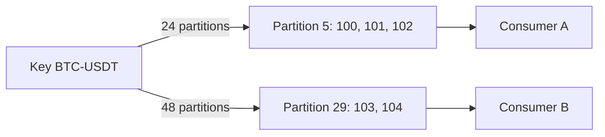
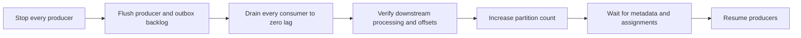

# Kafka partition expansion and ordering

## Status

The repository freezes order-sensitive partition counts and includes a
deterministic migration rehearsal using the production hash balancer. The
rehearsal covers dominant-market skew and old-topic backlog; live broker,
consumer-rebalance, and downstream-reconciliation acceptance remain required
before a migration.

## Summary

Praxis uses keyed Kafka records to preserve ordering for a business scope such
as an account, symbol, or matching-engine book. Its producers use a hash
partitioner. Conceptually, the destination is selected using the key and the
current partition count:

```text
partition = hash(key) mod partition_count
```

Increasing the partition count can therefore map an existing key to a new
partition. Kafka does not move records already written to the old partition.
During the transition, old and new records for one key can be processed from
different partitions concurrently, breaking the ordering assumption that the
key was intended to provide.

Partition expansion should not be treated as a routine online scaling action
for ordered Praxis topics.

## Example

Assume the partitioner produces a hash value of 29 for `BTC-USDT`:

```text
29 mod 24 = partition 5
29 mod 48 = partition 29
```

Before expansion, records 100 through 102 remain in partition 5. After the
topic is expanded, records 103 and 104 are written to partition 29.



Kafka preserves order within each partition, not across partitions. Consumer B
can complete records 103 and 104 before Consumer A completes 101 and 102. The
observed order could become:

```text
100, 103, 104, 101, 102
```

## Current Praxis key scopes

Current outbox producers use keys with different ordering intent:

| Event category | Kafka key | Intended ordering scope |
| --- | --- | --- |
| `OrderAccepted` | `symbol` | Matching market or book |
| `TradeBooked` | `engine_id:symbol` | Engine-owned market stream |
| `FundsReserved` | `user_asset_account_id` | One user-asset account |
| `FundsReleased` | `user_asset_account_id` | One user-asset account |
| `LedgerPosted` | `user_asset_account_id` | One user-asset account |
| `HoldReleased` | `user_asset_account_id` | One user-asset account |

The production topic definitions currently include 96 partitions for Matching
events and 24 each for Ledger commands and Ledger events. These counts provide
parallelism across different keys, but they do not make an individual key
parallel.

## Production failure modes

### Matching and market projections

If a symbol moves to a new partition while the old partition has backlog,
downstream consumers can observe newer engine sequences before older ones.
Possible consequences include:

- sequence gaps and false gap alarms;
- incorrect or temporarily divergent order-book projections;
- newer order states followed by older states;
- notifications delivered in the wrong order; and
- state for one symbol temporarily owned by two consumer tasks.

The dominant `BTC-USDT` market is particularly sensitive because it is expected
to represent more than 60% of trades. Increasing partitions does not split this
key; it only risks moving the key and its future records.

### TradeBooked consumers

If `engine_id:symbol` is remapped, a consumer may receive later trade sequences
from the new partition before earlier trades in the old partition. Strict
consumers may stop on the gap. Permissive consumers may construct incorrect
derived state.

Ledger's authoritative database has already booked these trades, so partition
reordering does not reverse the journal. It can still corrupt or delay
notifications, reporting, analytics, reconciliation inputs, and other derived
views.

### Account projections

An account key can move while older balance events are pending. A consumer
might process `FundsReleased` before an earlier `FundsReserved`, or apply an
older version after a newer one.

Depending on consumer behavior, this can cause:

- impossible or negative derived balances;
- stale state overwriting newer state;
- version conflicts;
- misleading customer notifications; and
- reconciliation discrepancies.

The authoritative Ledger transaction remains the source of truth, but every
projection must be repaired or rebuilt if it applies events incorrectly.

### Consumer-group rebalancing

New partitions must be assigned to consumers. Discovery and assignment can
trigger a consumer-group rebalance, briefly stopping work and changing
partition ownership. A rebalance is not itself an ordering violation, but it
adds operational movement during a migration that is already changing key
routing.

### Stateful processing

A stateful consumer may assume that all records for a key arrive in one task.
After expansion, historical state belongs to the task consuming the old
partition while new input arrives at the task consuming the new partition.
Without an explicit state migration or common external store, neither task has
a complete view.

## Idempotency is insufficient

Inbox deduplication answers whether a particular event ID has already been
processed. It does not determine whether event 103 is allowed to execute before
event 102.

```text
Deduplication: Have I processed evt_103 before?
Ordering:      Is sequence 102 complete before I apply sequence 103?
```

Consumers that depend on ordering need explicit sequence or entity-version
validation, gap handling, and a recovery procedure in addition to
deduplication.

## Unsafe approaches

### Increase partitions while traffic continues

This is unsafe when old partitions have backlog and consumers require key
ordering. Healthy brokers and exactly-once producer settings do not provide
cross-partition ordering.

### Assume the hash will remain stable

A stable key and stable hash function are not enough because the partition
count is an input to partition selection. Producer-library or partitioner
changes can create a similar remapping risk even without changing the topic.

### Dual-publish without a barrier

Writing every record to old and new topics does not establish which stream a
consumer should process first. A fast new-topic consumer can overtake the old
topic, and consumers may apply both copies unless deduplication is coordinated.

### Expand to solve one hot key

After expansion, all future records for `BTC-USDT` still share one partition.
The partition number may change, but the key is not divided. A hot key requires
a domain-aware architecture, not merely more physical partitions.

## Safer migration patterns

### Pattern 1: stop, drain, expand, resume

Use this approach when a maintenance window is acceptable.



The drain boundary must include successful downstream processing and committed
offsets. Empty producer buffers or an empty outbox do not prove that consumers
have completed old records.

This pattern preserves logical before-and-after ordering because no old work is
being processed when new mappings begin, but it introduces planned downtime
and requires a reliable proof that every consumer is drained.

### Pattern 2: migrate to a versioned topic

Create a new topic with the desired partition count:

```text
matching.events.v1 -> matching.events.v2
ledger.events.v1   -> ledger.events.v2
```

Use an explicit sequence or epoch barrier:

1. choose a final sequence or cutover epoch for the old topic;
2. ensure the old producer publishes through that barrier;
3. begin new-topic publication only under the documented cutover rule;
4. make consumers drain and validate the old stream through the barrier;
5. switch each consumer to the new stream from its first valid sequence;
6. quarantine gaps, duplicates, or events from the wrong epoch; and
7. retain the old topic through the rollback and audit window.

This makes the migration visible and reversible. It also allows independent
validation of partition count, retention, permissions, and consumer readiness.

### Pattern 3: coordinated dual publication

Zero-downtime migration may require a period of dual publication, but the two
streams still need a common event ID and an ordered barrier. Consumers must not
apply new-topic records until they have completed the old topic through that
barrier.

A migration coordinator must track readiness and prevent half-migrated
consumers from silently processing incompatible streams. This pattern is more
complex than a maintenance-window drain and should be justified by availability
requirements.

### Pattern 4: preserve existing assignments

A custom partitioner and durable assignment registry can retain existing keys
on their old partitions and use new partitions only for new keys. Every
producer must use the same assignment rules and version.

This avoids remapping but does not relieve existing hot keys. It also introduces
a routing registry whose availability, consistency, recovery, and rollout must
be operated as critical infrastructure.

## Consumer defenses

Regardless of migration pattern, stateful consumers should consider:

- an event ID for deduplication;
- a monotonic sequence or entity version;
- rejection or quarantine of stale versions;
- bounded waiting for missing sequences;
- a gap-repair or replay API;
- a rebuild procedure from the authoritative source;
- migration epoch metadata; and
- metrics for gaps, duplicates, stale events, and oldest pending sequence.

Not every consumer needs strict ordering. Consumers that do not should state
that explicitly so operational procedures do not impose unnecessary barriers.

## Recommended Praxis policy

Before changing an active topic's partition count:

1. inventory every producer, key function, consumer group, and ordering
   assumption;
2. verify the exact partitioner implementation and keep it stable through the
   migration;
3. classify each consumer as order-sensitive or order-insensitive;
4. measure per-partition lag and identify hot keys;
5. choose a stop-and-drain or versioned-topic migration;
6. define a sequence or epoch barrier and rollback point;
7. test the procedure with realistic backlog and dominant-market skew;
8. verify consumer rebalance and state recovery behavior;
9. reconcile downstream state against the authoritative database; and
10. retain evidence of offsets, barriers, topic configuration, and validation.

An in-place online increase should be prohibited for a topic with an
order-sensitive consumer unless a reviewed migration design proves how
cross-partition overlap is prevented.

Terraform enforces that policy for `matching.events.v1`, `ledger.commands.v1`,
and `ledger.events.v1` by freezing their accepted partition counts. Normal
plans fail if one of those counts changes. The
`allow_order_sensitive_partition_change` variable is an emergency migration
override, not a routine scaling control; it should only be enabled for an
approved and rehearsed migration, then immediately disabled. A new versioned
topic remains the default migration path.

## Repository rehearsal

Run the accepted 60%, 80%, and 95% dominant-market scenarios with:

```bash
make partition-migration-check
```

The checker uses `kafka.Hash`, the same balancer configured by the implemented
producers. It deterministically generates a configurable record set, retains a
backlog on the old mapping, and then admits records using the proposed mapping.
It fails unless at least one supplied key remaps, the unsafe online transition
demonstrates overtaking risk, and the stop-and-drain model has no overlap.

For a proposed topology, run a specific scenario from `outboxrelay`:

```bash
go run ./cmd/partition-migration-check \
  --old-partitions 24 --new-partitions 48 \
  --records 100000 --backlog 10000 --hot-percent 80 \
  --hot-key BTC-USDT --seed 42
```

The output records the old and new dominant-key partitions, remapped-key
count, generated hot records, backlog size, unsafe overtakes, and drain-barrier
overtakes. Save all scenario output with the migration review. This offline
proof does not satisfy the live checks for consumer rebalancing, sequence-gap
quarantine, authoritative reconciliation, or retained-topic replay.

## Verification scenarios

The future migration tooling and runbook should demonstrate:

1. A key that remaps under the proposed old and new counts is identified before
   production change.
2. Backlogged old-partition records cannot be overtaken by new-partition
   records at an order-sensitive consumer.
3. Consumer-group rebalancing does not lose or duplicate business effects.
4. Sequence gaps and stale versions are detected and quarantined.
5. Outbox events written around the cutover are assigned to exactly one valid
   migration epoch.
6. A producer or consumer rollback cannot silently mix incompatible mappings.
7. The dominant market remains ordered under at least 60%, 80%, and 95% traffic
   concentration.
8. Account-event projections reconcile with authoritative Ledger balances.
9. The old topic can be retained, audited, and replayed through the agreed
   retention period.
10. Expanding partitions is shown not to be the selected mitigation for a
    single hot key.

## Related implementation

- `outboxrelay/internal/messaging/kafka.go` configures the Ledger-event hash
  partitioner.
- `matchingengine/internal/relay/relay.go` configures the Matching-event hash
  partitioner.
- `ledgerservice/internal/store/postgres.go` selects account and
  engine-symbol message keys.
- `matchingengine/internal/engine/engine.go` selects the symbol key.
- `infra/aws/variables.tf` defines current production topic partition counts
  and the explicit migration override.
- `infra/aws/messaging-topics.tf` rejects unapproved partition-count changes
  for the order-sensitive topics.
- `docs/dominant-market-hotspots.md` describes the `BTC-USDT` hot-key and
  sequencing problem.

## References

- [Apache Kafka ProducerRecord](https://kafka.apache.org/43/javadoc/org/apache/kafka/clients/producer/ProducerRecord.html)
- [Apache Kafka producer configuration](https://kafka.apache.org/40/configuration/producer-configs/)
- [Apache Kafka design](https://kafka.apache.org/20/design/design/)
