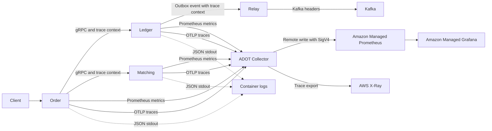
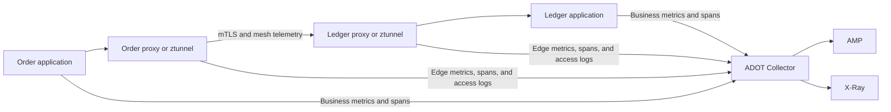

# Praxis observability and Istio

## Status

This document records the current Praxis observability architecture and a
possible future Istio integration. It is a design note only; Istio and the
described telemetry changes are not currently implemented.

## Current observability architecture

Praxis combines application metrics, OpenTelemetry traces, structured logs,
and health endpoints. The local and AWS deployments use different storage
backends but share the same general instrumentation model.



Locally, Prometheus scrapes application and host metrics, services send traces
through an OpenTelemetry Collector to Tempo, and Grafana provides dashboards
and trace exploration. In AWS, the intended EKS pipeline uses a shared ADOT
Collector to send metrics to Amazon Managed Prometheus and traces to X-Ray.

### Application metrics

Order, Ledger, Matching, and Outbox expose Prometheus text endpoints. Their
metrics describe application and business behavior, including:

- order acceptance, rejection, and failure rates;
- risk, reservation, Matching, and total order latency;
- saga dead letters and recovery-worker panics;
- Ledger operations and database-pool behavior;
- Matching submissions and failures; and
- Outbox claims, publications, failures, and batch duration.

The EKS ADOT Collector discovers the Order, Ledger, and Matching pods in the
`praxis` namespace, scrapes their named HTTP ports every 30 seconds, adds
environment and cluster resource attributes, and remotely writes the samples
to AMP. Outbox runs on ECS and uses a separate, optional task-local collector.

### Distributed traces

The Go services use the OpenTelemetry SDK and instrumentation for HTTP and
gRPC. The trace provider uses parent-based ratio sampling and exports over
OTLP/gRPC. Praxis propagates W3C `traceparent` and `tracestate` values through:

1. inbound and outbound HTTP;
2. synchronous gRPC calls;
3. durable outbox records; and
4. Kafka message headers.

Application spans expose business stages such as risk checks, Ledger reserve
calls, Matching submissions, and event publication. This instrumentation is
necessary for asynchronous and domain-specific operations that a network proxy
cannot infer.

### Logs

Services emit structured JSON logs through Go's `slog`. ECS workloads use
CloudWatch Logs. Central shipping and durable retention for EKS application
logs remain future work.

### Health and readiness

Each service provides `/healthz` and dependency-aware `/readyz` endpoints.
Ledger and Matching also expose the standard gRPC health service, and Order
readiness checks its synchronous dependencies.

### Known gaps

- Live AWS metric and trace ingestion has not been fully verified.
- The shared EKS collector has one replica and is not highly available.
- EKS application-log shipping is incomplete.
- Outbox observability is optional and separate from the EKS pipeline.
- Current dashboards do not consistently separate application time from
  transport, proxy, connection, and upstream time.
- Alert delivery and production rollback exercises still require verification.

## What Istio could add

Istio would add telemetry at the service-communication boundary while also
providing workload identity, mTLS, and authorization. It should complement the
current application instrumentation rather than replace it.



### Uniform edge metrics

For HTTP, HTTP/2, and gRPC traffic, Istio can report request count, duration,
request and response size, response code, and gRPC message counts. TCP telemetry
can include bytes and connection counts. Dimensions identify source and
destination workloads and whether the connection used mTLS.

These metrics would provide a consistent rate, error, and duration view for
Order-to-Ledger and Order-to-Matching traffic, including failures that occur
before a request reaches a Go handler.

### Proxy spans

Istio can generate client-side and server-side proxy spans and export them over
OTLP. Joined with the existing application spans, a trace could distinguish:

```text
Order application work
  -> Order outbound proxy
    -> network and mTLS
      -> Ledger inbound proxy
        -> Ledger application work
```

Praxis must continue propagating W3C trace headers for these spans to form one
trace. Proxy spans do not replace spans for risk evaluation, saga transitions,
SQL, outbox state, Kafka, or other business behavior.

### Access logs

Istio can emit structured access logs containing workload identities, response
status, duration, byte counts, upstream hosts, termination reasons, transport
errors, and request identifiers. These logs would be useful for diagnosing:

- mTLS and authorization denials;
- upstream resets and timeouts;
- traffic that never reached the application;
- routing and service-discovery errors; and
- retry or circuit-breaking behavior at the proxy boundary.

Access logs should be filtered and sampled where possible. Persistently logging
every successful request would add substantial ingestion volume and cost.

## Responsibility boundaries

Istio and application telemetry answer different questions:

| Question | Primary telemetry source |
| --- | --- |
| How many orders were accepted? | Order application metric |
| Why was an order rejected? | Application span and structured log |
| Which saga was dead-lettered? | Application metric, log, and database |
| Did an Outbox event publish? | Outbox instrumentation |
| What is the Order-to-Ledger latency and error rate? | Istio edge metric |
| Was the connection protected by mTLS? | Istio metric and access log |
| Did a reset occur before Ledger handled the call? | Istio proxy telemetry |
| Which SQL operation was slow? | Application or database instrumentation |

The existing application metrics and traces remain authoritative for business
outcomes. Mesh telemetry describes transport and workload-to-workload behavior.

## Collection and storage integration

Installing Istio alone would not put its telemetry into the existing AWS
backends. The collector configuration must be expanded deliberately.

For sidecar mode, collection must discover and scrape Envoy proxy telemetry in
addition to the named application HTTP ports. For ambient mode, collection must
cover ztunnel, any waypoint proxies, and Istiod. The current collector watches
only selected pods and ports in the `praxis` namespace, so its discovery rules
and RBAC would require changes for Istio components outside that namespace.

Istio-generated traces should use the existing OTLP collector endpoint. Mesh
and application sampling policies must be coordinated to avoid incomplete or
unexpectedly expensive traces. Resource attributes should preserve cluster,
namespace, workload, service, revision, and environment identity without adding
unbounded labels.

Access logs require a durable EKS log pipeline or an OTLP log pipeline before
they can be treated as production evidence. Log fields must exclude credentials,
authorization headers, personal data, and full financial payloads.

## Costs and operational risks

Mesh telemetry can materially increase:

- Prometheus time-series count and label cardinality;
- trace spans per request;
- log ingestion and retention cost;
- proxy, collector, and backend CPU and memory use; and
- the number of dashboards and alerts operators must interpret.

Client and server proxies may both report the same logical request. Application
and proxy tracing may also produce adjacent spans with similar names. Dashboards
must distinguish reporter direction and telemetry layer so that duplicate views
are not interpreted as duplicate business operations.

Istio also creates telemetry about its own control plane and data plane. Alerts
for certificate rotation, rejected configuration, proxy synchronization, and
telemetry export health become part of operating the system.

## Recommended future approach

Use a hybrid model:

1. Retain all current application business metrics and OpenTelemetry spans.
2. Introduce Istio primarily for mTLS and workload authorization.
3. Enable standard mesh request metrics for Ledger and Matching first.
4. Add proxy tracing at a low initial sampling rate and export through ADOT.
5. Enable access logs first for errors, denials, and abnormal terminations.
6. Extend collector discovery, RBAC, resource limits, and dashboards.
7. Add a durable EKS application and proxy log destination.
8. Make collection highly available using target allocation or backend
   deduplication rather than simply duplicating Prometheus scrapes.
9. Establish metric-label, trace-sampling, log-volume, retention, and cost
   budgets before expanding mesh-wide.
10. Verify the full pipeline with real traffic and failure injection before
    using it for production paging or incident decisions.

Istio should not be introduced solely to replace the existing observability
stack. Its strongest value for Praxis is the combination of service identity,
mTLS, authorization, and uniform transport telemetry.

## Suggested rollout

### Phase 1: establish a baseline

- Deploy and verify the current ADOT, AMP, X-Ray, Grafana, and alert pipeline.
- Complete EKS log shipping.
- Measure existing telemetry volume, cardinality, cost, and query performance.
- Record baseline Order-to-Ledger and Order-to-Matching latency and error rates.

### Phase 2: enroll the financial path

- Enroll Order, Ledger, and Matching in the mesh.
- Apply strict mTLS and identity authorization to Ledger and Matching.
- Keep public ingress, health probes, telemetry export, Kafka, and database
  paths explicitly accounted for during migration.
- Verify that application metrics and traces are unchanged.

### Phase 3: add mesh metrics

- Collect standard Istio request metrics.
- Add edge dashboards for Order-to-Ledger and Order-to-Matching.
- Verify the `mutual_tls` security-policy label and source workload identities.
- Apply label allowlists or metric overrides if cardinality exceeds the budget.

### Phase 4: add traces and access logs

- Export sampled proxy spans over OTLP.
- Confirm that proxy spans join the existing W3C application traces.
- Enable filtered structured access logs.
- Validate that sensitive request metadata and financial payloads are excluded.

### Phase 5: production hardening

- Load-test proxy and collector overhead.
- Test collector, Istiod, proxy, and telemetry-backend failures.
- Verify dashboards, alerts, log searches, trace searches, and retention.
- Document rollback procedures and rehearse removing a workload from the mesh.

## Acceptance criteria

The future integration should not be considered complete until:

- Order, Ledger, and Matching application telemetry remains available;
- every intended internal gRPC connection is verifiably protected by mTLS;
- unauthorized workload identities are denied and observable;
- mesh request metrics reach AMP with controlled cardinality;
- proxy spans join application traces in X-Ray;
- error access logs reach a durable searchable backend;
- the collector pipeline tolerates a replica or node failure;
- telemetry overhead stays within defined latency and resource budgets; and
- operators have tested dashboards, alerts, and rollback procedures.

## Related implementation

- `infra/k8s/collector.tf` defines the shared EKS ADOT metrics and trace
  pipelines.
- `infra/aws/observability-amp.tf` and
  `infra/aws/observability-grafana.tf` define managed metrics and dashboard
  infrastructure.
- `infra/grafana` contains the managed Grafana data source, dashboard, alerts,
  and ingestion verification.
- Each service's `internal/observability/tracing.go` configures OpenTelemetry
  tracing.
- Service HTTP handlers expose `/metrics`, `/healthz`, and `/readyz`.
- `outboxrelay/internal/relay/relay.go` propagates W3C trace context into Kafka
  messages.
