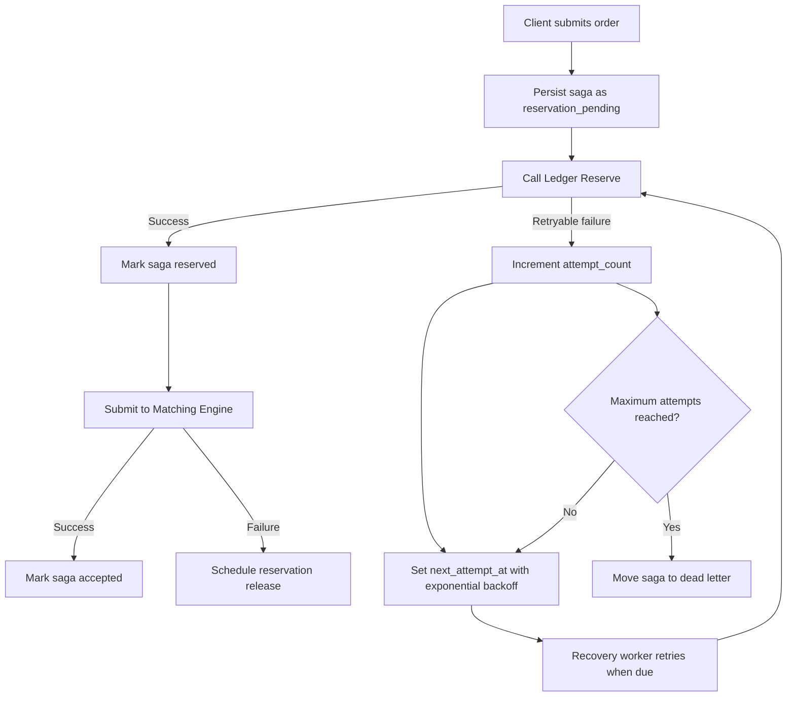
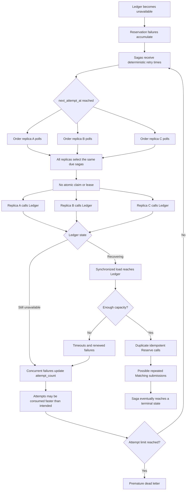
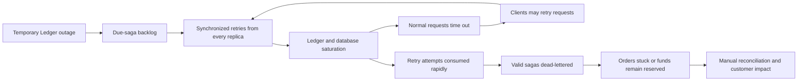
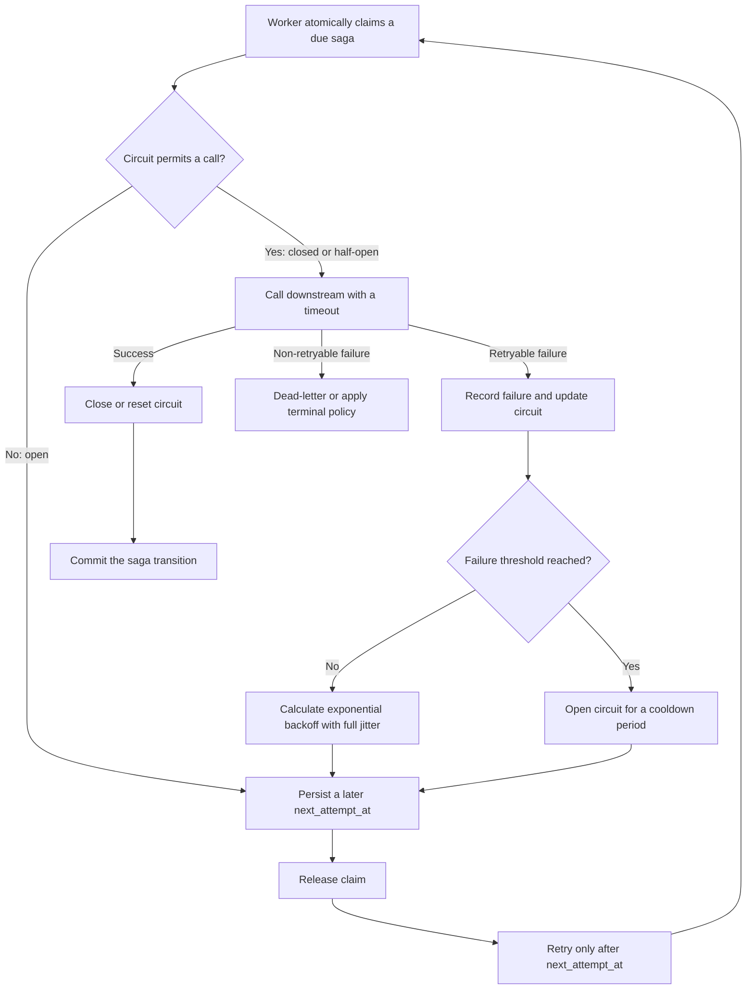

# Order saga retry storms

## Summary

Praxis can produce a retry storm when a dependency such as Ledger becomes
unavailable and many order sagas become due at the same time. The risk is
greatest when more than one Order Service replica runs against the same saga
database.

The saga retry policy is bounded and uses exponential backoff, but retries have
no jitter and due sagas are read without being atomically claimed. Consequently,
multiple replicas can select the same saga and call Ledger concurrently. This
can turn a temporary outage into a cascading outage and can consume a saga's
attempt budget faster than intended.

Ledger command idempotency limits duplicate financial effects. It does not
eliminate duplicate traffic, repeated Matching Engine submissions, premature
dead-lettering, or reservations that remain open until manual reconciliation.

## How recovery normally works

When an order is admitted, Order Service persists an `order_sagas` row in the
`reservation_pending` state before asking Ledger to reserve funds. If that call
fails with a retryable error, Order Service:

1. increments `attempt_count`;
2. leaves the saga in `reservation_pending`;
3. calculates `next_attempt_at` using exponential backoff; and
4. dead-letters the saga after the configured maximum number of attempts.

Reservation and release retries default to a maximum of 10 attempts. Their
delay grows from approximately 1 second to a maximum of 300 seconds. A recovery
worker wakes every `ORDER_SAGA_RETRY_INTERVAL`, which defaults to 1 second, and
loads up to 100 due reservations followed by up to 100 due releases.

## How a retry storm develops

`DueReservations` and `DueReleases` perform ordinary `SELECT` queries. They do
not atomically claim rows, assign a lease, or use `FOR UPDATE SKIP LOCKED`.
Therefore, every Order Service replica can observe the same due rows before any
replica changes their state.

Because retry times and worker polling intervals have no jitter, sagas that fail
together also tend to become due together. A large backlog is then released in
synchronized batches.

The same pattern applies to reservation release. A release retry uses a stable
command ID, so Ledger should treat duplicate commands idempotently, but every
duplicate still consumes connections, CPU, database capacity, and network
bandwidth.

## Cascading consequences

The worst outcome is a cascading outage combined with orders stuck in
intermediate states.

Possible consequences include:

- **Prolonged dependency outage.** A recovering Ledger instance receives a
  synchronized surge and fails again before it stabilizes.
- **Order API degradation.** Retry traffic competes with new orders for Ledger,
  database, connection-pool, CPU, and network capacity.
- **Premature dead-lettering.** Concurrent workers can record multiple failures
  for what operators would consider one retry window.
- **Unavailable customer funds.** A release saga that reaches the dead-letter
  state can leave funds reserved until an operator reconciles it.
- **Repeated downstream work.** Stable command and request IDs should prevent
  duplicate business effects where idempotency is correctly implemented, but
  Ledger and Matching Engine must still process the duplicate calls.
- **Operational backlog.** Dead letters and uncertain intermediate states need
  investigation and replay after the incident.

The primary financial risk is not necessarily creating or reserving money
twice, because Ledger commands are idempotent. It is loss of availability and
temporarily inaccessible customer funds, with correctness depending on every
downstream idempotency boundary working as intended.

## Existing safeguards

Praxis already has several useful controls:

- exponential backoff for reservation and release failures;
- a configurable maximum attempt count and durable dead-letter records;
- stable command IDs for release operations;
- request identifiers used at Ledger and Matching Engine idempotency boundaries;
- per-call timeouts; and
- batches limited to 100 due reservations and 100 due releases per recovery
  cycle.

These controls bound an individual replica's work, but they do not coordinate
work across replicas or spread retries over time.

## Recommended changes

### Runtime control boundary

Retry recovery should be implemented as deterministic Go code, not delegated to
an AI agent. Backoff, jitter, error classification, circuit state, attempt
limits, and half-open probes are protocol behavior that must remain predictable,
testable, and auditable. An AI dependency in this path would add latency,
nondeterminism, and another failure and retry layer.

After its cooldown, the circuit breaker itself should test whether the
downstream service has recovered by allowing a small, bounded number of
half-open calls. A successful probe closes the circuit; another transient
failure reopens it and schedules a later probe.

AI can remain outside this control loop as an advisory operations tool—for
example, to summarize dead letters, correlate telemetry, propose configuration
changes for human approval, or help generate failure tests. It should not
decide whether to reserve or release funds, override retry limits, change
circuit state, or autonomously replay dead letters.

### 1. Atomically claim due sagas

Add claim ownership and expiry fields to `order_sagas`, then select work inside
a transaction using `FOR UPDATE SKIP LOCKED`. A worker should only execute a
saga for which it owns a live lease. This is the highest-priority change because
it prevents replicas from intentionally processing the same due row.

Lease duration must exceed the normal downstream-call duration, or workers must
renew leases while executing. State transitions should verify the claim owner
to prevent a worker with an expired lease from overwriting newer progress.

### 2. Add retry jitter

Apply full jitter to each backoff window rather than storing identical retry
times. For a calculated maximum delay `d`, choose a random delay in `[0, d]`,
subject to a small minimum delay if needed. Jitter should also be applied to the
recovery worker's initial poll so newly started replicas do not synchronize.

### 3. Limit retry concurrency and rate

Use a shared or deliberately partitioned retry budget for each downstream
dependency. Bound concurrent Ledger reservations and releases independently,
and reserve capacity for new requests so recovery work cannot starve normal
traffic.

### 4. Make retry budgets explicit

Treat client, gRPC, saga-worker, and downstream retries as one end-to-end retry
budget. Avoid adding transparent retries at every layer. Stop or slow recovery
when dependency health, timeout rate, or saturation indicates that retries are
making recovery worse.

### 5. Improve observability

At minimum, expose and alert on:

- due saga count and age of the oldest due saga;
- retry attempts by stage and error code;
- retry and dead-letter rates;
- active claims, lease expirations, and claim conflicts;
- Ledger call concurrency, latency, and timeout rate; and
- the number of sagas processed more than once in one retry window.

## Verification scenarios

Tests for the mitigation should include:

1. Run several Order Service replicas against one saga database and verify that
   only one replica claims each due saga.
2. Make Ledger unavailable long enough to accumulate a large backlog, then
   restore it and verify that calls remain within the configured rate and
   concurrency limits.
3. Expire a worker lease during a downstream call and verify that stale workers
   cannot overwrite a newer state transition.
4. Crash a worker after the downstream call but before committing the saga
   transition and verify safe replay through the idempotency key.
5. Confirm statistically that retry times are distributed across their jitter
   windows rather than clustering at exact powers of two.
6. Verify that one logical retry window cannot consume several attempts merely
   because multiple replicas are running.

## Related implementation

- `orderservice/internal/order/postgres_saga.go` contains retry scheduling,
  dead-letter transitions, and due-saga queries.
- `orderservice/internal/order/service.go` contains the recovery loop and calls
  to Ledger and Matching Engine.
- `orderservice/internal/config/config.go` defines recovery intervals and
  maximum attempt settings.
- `outboxrelay/internal/store/postgres.go` demonstrates a lease-based pattern
  using `FOR UPDATE SKIP LOCKED` that can inform saga claiming.
