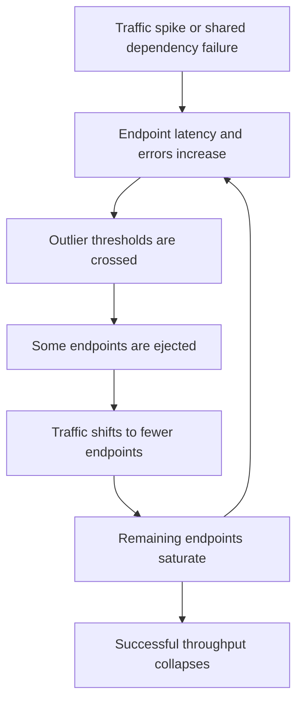
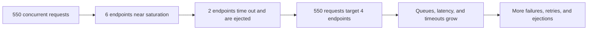

# Outlier detection and ejection spirals

## Status

This document describes a production failure mode to consider if Praxis enables
endpoint outlier detection in a service mesh or client-side load balancer. It
is a design and operations note only; outlier detection is not currently part
of the documented Praxis runtime configuration.

## Summary

Outlier detection passively observes endpoint failures and temporarily removes
unhealthy endpoints from load balancing. It is useful when one pod is failing
independently of its peers, but it can amplify overload when failures are
widespread or correlated.

A traffic spike does not directly cause an ejection. It first causes symptoms
such as timeouts, resets, or error responses. If those observations cross the
configured thresholds, the detector may eject endpoints. Their traffic then
moves to fewer remaining endpoints, which can become overloaded and fail the
same checks. This positive-feedback loop is an **ejection spiral**.

In production, the resulting outage is usually a combined capacity, timeout,
and retry cascade rather than every endpoint literally being ejected. An
ejection cap can leave endpoints in service while those endpoints are too
saturated to do useful work.

## When outlier detection helps

Ejection is effective when a failure is isolated, for example:

- one pod has a broken connection pool or corrupted local state;
- one node or network path is impaired;
- a newly deployed pod has a host-specific defect; or
- one endpoint consistently resets connections while its peers remain healthy.

Removing that endpoint prevents callers from repeatedly selecting it and gives
it time to recover. The remaining healthy capacity must be sufficient to carry
the redistributed load.

## When it can make an incident worse

The risk is greatest when endpoints are failing for the same reason:

- a shared database, Kafka cluster, or downstream service is unhealthy;
- a traffic spike pushes the entire fleet beyond sustainable concurrency;
- clients time out before valid but slow responses arrive;
- retries multiply the offered load;
- a zone or locality loses a large fraction of its capacity; or
- a deployment introduces the same fault into every new replica.

These are correlated failures. Ejecting individual endpoints does not isolate
the cause. Instead, it reduces effective capacity and concentrates work on the
remaining endpoints.

For example, assume six Ledger endpoints can each sustain 100 concurrent
requests. At 550 concurrent requests the fleet is already close to its
600-request capacity. If two endpoints begin timing out and are ejected, the
remaining capacity falls to approximately 400 while the offered load remains
550. Unless work is rejected or callers slow down, more endpoints are likely to
cross the same failure threshold.

## Amplifiers

Several policies can turn a recoverable event into a cascade:

- **Aggressive detection.** Low error thresholds or insufficient request
  volume allow short-lived noise to eject an endpoint.
- **Long ejection periods.** Healthy capacity remains unavailable after the
  original disturbance has passed.
- **Unbounded retries.** Each timeout creates additional requests and can make
  the measured failure rate worse.
- **Short caller deadlines.** A saturated but functioning endpoint is counted
  as failed because callers abandon work too quickly.
- **Large queues.** Queued requests consume memory and continue arriving after
  the service has exceeded useful capacity.
- **Slow autoscaling.** New replicas may arrive after the feedback loop is
  already established, and they may immediately receive more load than they can
  warm up safely.
- **Per-proxy decisions.** Different proxies can eject different endpoints, so
  the aggregate behavior may be less obvious than a single global percentage.
- **Locality imbalance.** A global fleet can look healthy while one zone,
  priority, or endpoint subset has lost most of its usable capacity.

## Required safeguards

Outlier detection should be one layer of protection, not the overload-control
mechanism.

### Bound capacity removal

Configure a conservative maximum ejection percentage and evaluate it per
locality and priority, not only across the whole fleet. The limit should
preserve enough known-good capacity for the expected load. A cap limits damage
from the detector, but it cannot make saturated endpoints healthy.

Require enough observations before acting. Consecutive-error, failure-rate,
and success-rate policies should use meaningful request-volume and host-count
thresholds so that one or two requests do not determine an endpoint's state.

### Shed excess load

When the fleet cannot serve all offered work, reject excess work promptly and
predictably. Bound concurrent requests, connection pools, pending-request
queues, and background recovery work. This protects latency for admitted work
and prevents every endpoint from failing slowly.

Rate limits at the Order API are useful at ingress, but each internal
dependency also needs a capacity boundary. A shared dependency incident can
otherwise consume Ledger or Matching capacity through internal retries and
recovery workers even when external traffic is controlled.

### Bound retries

Use a retry budget shared across application, gRPC, proxy, and saga layers.
Retry only explicitly classified transient failures, apply backoff and jitter,
and keep every attempt inside the original request deadline. For financial
mutations, automatic retries also require a stable idempotency key and verified
server-side replay semantics.

Retries should stop when they are unlikely to succeed or when the destination
is already saturated. Hedging and simultaneous retries are particularly risky
during an ejection spiral.

### Recover gradually

Ejections should be temporary. Reintroduce endpoints with a small number of
probe requests or another gradual-ramp mechanism before giving them a full
traffic share. Bringing many endpoints back at once can create a recovery wave,
while repeatedly ejecting and restoring them creates flapping.

Autoscaling should use leading saturation signals such as active concurrency,
queue depth, and request rate where practical. It is a capacity-management
layer, not the immediate defense against overload.

## Observability

Alerting should relate endpoint health to remaining capacity. At minimum,
observe:

- active and ejected endpoint counts by service, zone, and reason;
- percentage of usable capacity remaining;
- request rate and active concurrency per endpoint;
- queue depth, queue delay, and rejected work;
- latency distributions, timeouts, resets, and error codes;
- original requests compared with retry attempts;
- dependency health and connection-pool saturation; and
- ejection, reinstatement, and flapping rates.

An ejection event alone is not necessarily an incident. The dangerous signal
is ejection combined with rising saturation, retries, latency, and falling
successful throughput on the remaining endpoints.

## Validation before production

Exercise the complete policy under load rather than validating only that a bad
pod is removed:

1. establish normal and peak sustainable throughput;
2. fail one endpoint independently and verify that ejection improves success
   rate;
3. overload the whole fleet and verify that admission control activates before
   successful throughput collapses;
4. degrade a shared dependency and confirm that endpoint ejection does not
   accelerate capacity loss;
5. inject latency as well as explicit errors, because timeout cascades are a
   common production path;
6. confirm that retries remain within the end-to-end budget;
7. test a zone-level failure and inspect remaining capacity in every locality;
8. verify gradual recovery without synchronized reinstatement or flapping; and
9. repeat the tests during scale-out and a rolling deployment.

The primary acceptance criterion is not merely that an unhealthy endpoint is
ejected. Successful throughput should degrade gracefully, bounded rejection
should occur before uncontrolled timeouts, and the system should recover
without another load wave.

## Recommended Praxis policy

If Praxis enables Istio-managed outlier detection, begin with detection aimed
at clear, independently unhealthy endpoints and a conservative capacity-removal
limit. Keep overload protection in explicit concurrency, queue, and admission
controls. Treat fleet-wide or shared-dependency failures as overload events,
not evidence that every endpoint should be removed.

The governing principle is:

> Outlier detection should isolate independently unhealthy endpoints. When
> failures are widespread or correlated, it should preserve capacity while
> load shedding and backpressure protect the system.

This policy should be reviewed together with
[gRPC load balancing](grpc-load-balancing.md),
[Order API rate limiting](order-api-rate-limiting.md), and
[Order saga retry storms](order-saga-retry-storms.md).
